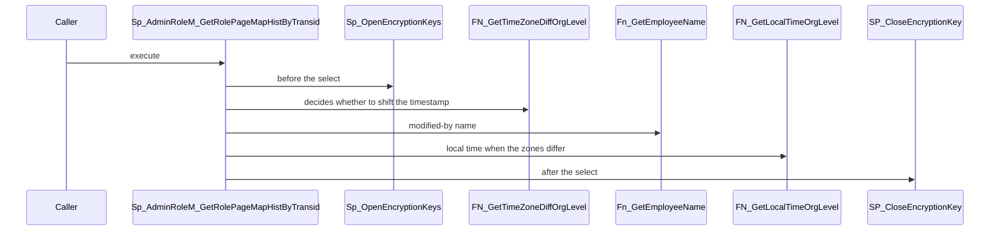
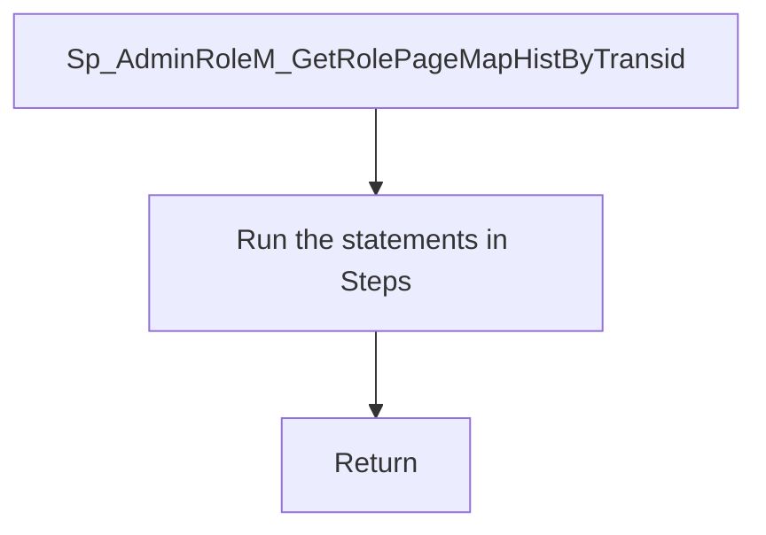

# Sp_AdminRoleM_GetRolePageMapHistByTransid

## What it does

Returns the distinct history events for a role's page mapping: role name, transaction id, who modified it, and the modified date. The date uses the employer time zone when the server zone differs.

## Parameters

| Name | Direction | What it is for |
|---|---|---|
| `@RoleId` | in | Role |
| `@Employerid` | in | Employer, also used for the time-zone check |

## Call sequence

## Callers

No other procedure or function calls this object.

## Nested

| Object | Kind | When | Page |
|---|---|---|
| `Sp_OpenEncryptionKeys` | procedure | before the select | [Sp_OpenEncryptionKeys](/docs/database/hrms/Sp_OpenEncryptionKeys) |
| `FN_GetTimeZoneDiffOrgLevel` | function | decides whether to shift the timestamp | [FN_GetTimeZoneDiffOrgLevel](/docs/database/hrms/FN_GetTimeZoneDiffOrgLevel) |
| `Fn_GetEmployeeName` | function | modified-by name | [Fn_GetEmployeeName](/docs/database/hrms/Fn_GetEmployeeName) |
| `FN_GetLocalTimeOrgLevel` | function | local time when the zones differ | [FN_GetLocalTimeOrgLevel](/docs/database/hrms/FN_GetLocalTimeOrgLevel) |
| `SP_CloseEncryptionKey` | procedure | after the select | [SP_CloseEncryptionKey](/docs/database/hrms/SP_CloseEncryptionKey) |

## Steps

1. Open encryption keys and read whether the employer time zone differs from the server.
2. Return distinct role, transaction, modifier, and date rows from the current mapping and its history.
3. When the zones differ, convert the UTC modify time with FN_GetLocalTimeOrgLevel.
4. Close encryption keys.

## Tables

| Table | Read or write |
|---|---|
| `TRoles` | read |
| `TRolePagesMapping` | read |
| `TRolePagesMappingHistory` | read |

## Flow

