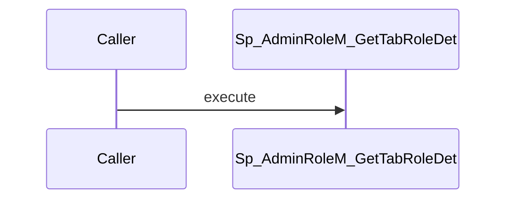
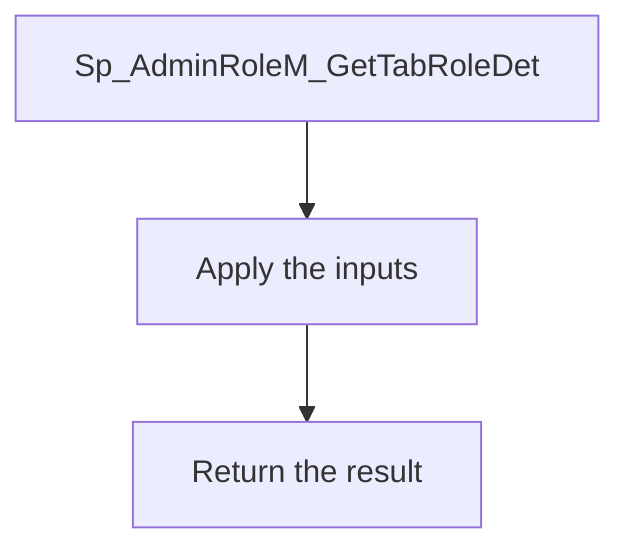

# Sp_AdminRoleM_GetTabRoleDet

## What it does

Returns every tab the role may open, for every menu. The attendance card then keeps the rows for menu 1173 to decide leave, AR, WFH, and OD actions.

## Parameters

| Name | Direction | What it is for |
|---|---|---|
| `@Employerid` | in | Employer that owns the data (`Int`) |
| `@RoleId` | in | Role whose tab grants are loaded (`Int`) |

## Call sequence

## Callers

No other procedure or function under STOREPROCEDURE or FUNCTIONS executes this object.

## Nested

This object does not execute another procedure or user-defined function.

## Steps

In `HRMS-DATABASE/HRMS/STOREPROCEDURE/Sp_AdminRoleM_GetTabRoleDet.sql`:

1. Returns every tab the role may open, for every menu.
2. The attendance card then keeps the rows for menu 1173 to decide leave, AR, WFH, and OD actions.

## Tables

| Table | Read or write |
|---|---|
| `TRoleTabDetails` | read |

## Flow

