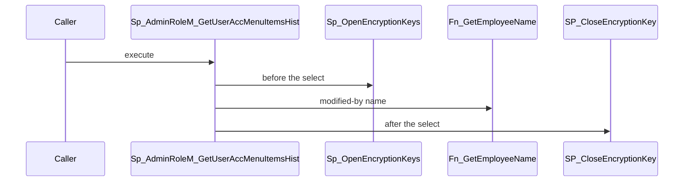
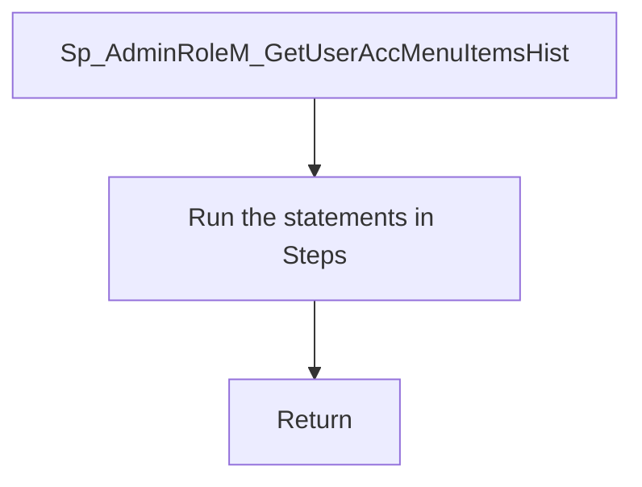

# Sp_AdminRoleM_GetUserAccMenuItemsHist

## What it does

Returns a user's extra pages. Transaction id 0 reads TUSerPagesMapping. Any other id reads TUSerPagesMappingHistory for that transaction. Menu names come from TMenuDetails for the user's employer.

## Parameters

| Name | Direction | What it is for |
|---|---|---|
| `@Userid` | in | User |
| `@TransID` | in | 0 for the current grant, otherwise a history transaction |

## Call sequence

## Callers

No other procedure or function calls this object.

## Nested

| Object | Kind | When | Page |
|---|---|---|
| `Sp_OpenEncryptionKeys` | procedure | before the select | [Sp_OpenEncryptionKeys](/docs/database/hrms/Sp_OpenEncryptionKeys) |
| `Fn_GetEmployeeName` | function | modified-by name | [Fn_GetEmployeeName](/docs/database/hrms/Fn_GetEmployeeName) |
| `SP_CloseEncryptionKey` | procedure | after the select | [SP_CloseEncryptionKey](/docs/database/hrms/SP_CloseEncryptionKey) |

## Steps

1. Open encryption keys.
2. When @TransID is 0, read current pages, menu name, creator, and creation date.
3. Otherwise read the history transaction, newest first.
4. Close encryption keys.

## Tables

| Table | Read or write |
|---|---|
| `TUSerPagesMapping` | read |
| `TUSerPagesMappingHistory` | read |
| `TMenuDetails` | read |
| `TUsers` | read |

## Flow

