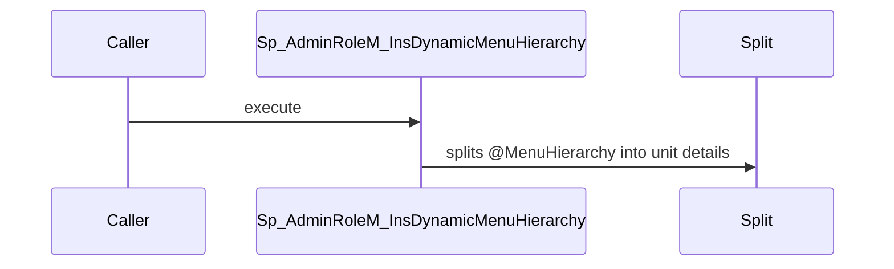
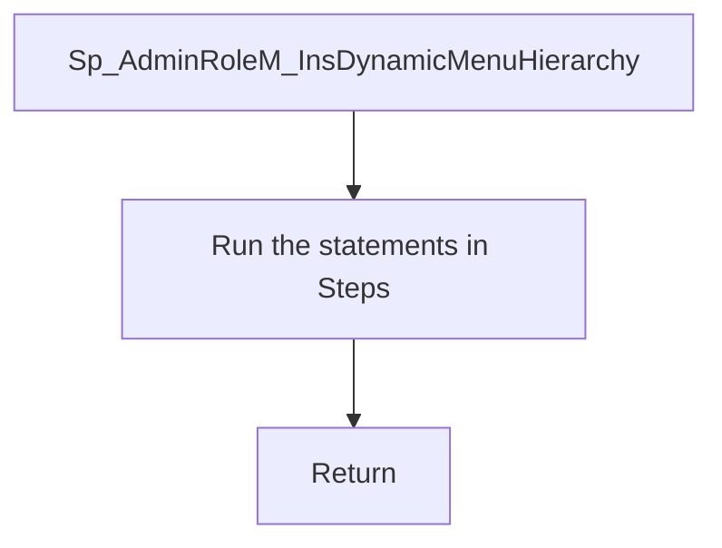

# Sp_AdminRoleM_InsDynamicMenuHierarchy

## What it does

Replaces the dynamic menu for an employer, or for every active child whose root employer is @Employerid. It stores the menu XML, then rebuilds TMenuHierarchy and tMenuDetails from the submitted unit list, copying icon and URL from the employer-0 menu. Each delete and insert is copied into the matching history table.

## Parameters

| Name | Direction | What it is for |
|---|---|---|
| `@DynamicMenuXML` | in | Menu tree XML |
| `@MenuHierarchy` | in | Comma-separated unit details parsed on ~ |
| `@CreatedBy` | in | Employee id stored on the new rows and history |
| `@Employerid` | in | Root employer. When no active children exist, the procedure writes this employer only |

## Call sequence

## Callers

No other procedure or function calls this object.

## Nested

| Object | Kind | When | Page |
|---|---|---|
| `Split` | function | splits @MenuHierarchy into unit details | [Split](/docs/database/hrms/Split) |

## Steps

1. Collect active TEmployerDetails rows whose RootEmployerId is @Employerid. If none, use @Employerid alone.
2. Split @MenuHierarchy and parse each token into unit id, menu name, and parent unit id.
3. For each employer, delete TDynamicMenuHierarchy, TMenuHierarchy, and tMenuDetails into their history tables with action D.
4. Insert the new XML into TDynamicMenuHierarchy.
5. Insert hierarchy and menu-detail rows from the parsed units, copying parent sequence, icon, URL, and page name from the employer-0 rows, and write history action I.

## Tables

| Table | Read or write |
|---|---|
| `TEmployerDetails` | read |
| `TDynamicMenuHierarchy` | write |
| `TDynamicMenuHierarchyHistory` | write |
| `TMenuHierarchy` | read and write |
| `TMenuHierarchyHistory` | write |
| `tMenuDetails` | read and write |
| `tMenuDetailsHistory` | write |

## Flow

