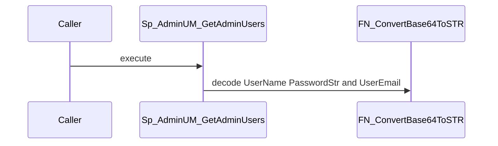
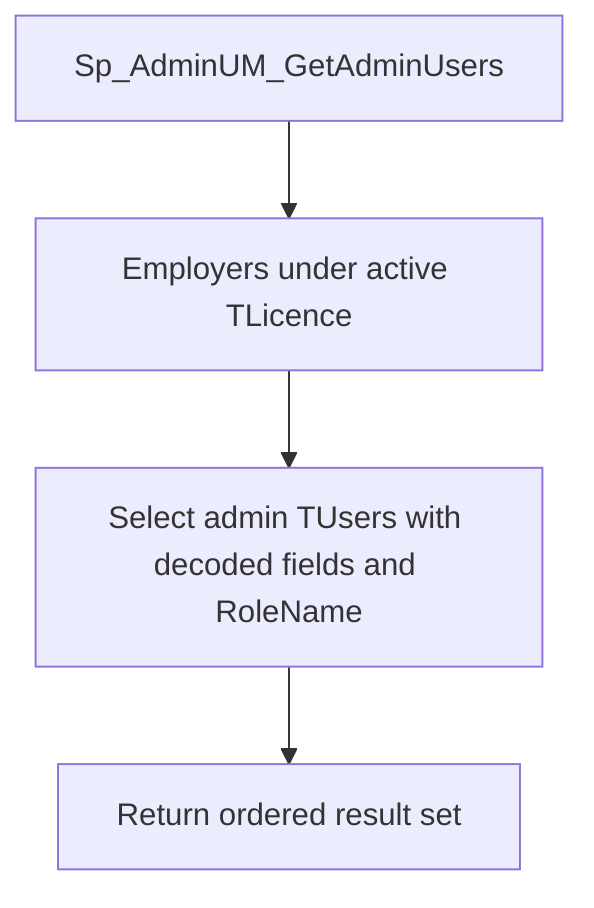

# Sp_AdminUM_GetAdminUsers

## What it does

Returns administrator users (`TUsers.UserType` `A`) for organisations that sit under an employer with an active row in `TLicence`. User name, password, and email are decoded with `FN_ConvertBase64ToSTR`. Role name is the matching `TRoles.RoleName` for the same employer.

## Parameters

| Name | Direction | What it is for |
|---|---|---|
| — | — | The procedure takes no parameters |

## Call sequence

## Callers

No other procedure or function calls this object. `UserManagementDAL.GetAllAdminUsers` executes it from Create New User (`AddUser.aspx.cs`).

## Nested

| Object | Kind | When | Page |
|---|---|---|---|
| `FN_ConvertBase64ToSTR` | function | decode `UserName`, `PasswordStr`, and `UserEmail` in the select list | [FN_ConvertBase64ToSTR](/docs/database/hrms/FN_ConvertBase64ToSTR) |

## Steps

1. In `HRMS-DATABASE/HRMS/STOREPROCEDURE/Sp_AdminUM_GetAdminUsers.sql`, set `NOCOUNT ON` and `READ UNCOMMITTED`.
2. Build a table variable of distinct `TEmployerDetails.Employerid` values whose `RootEmployerId` matches an active `TLicence.EmployerID` (`LicenceStatus` `Active`).
3. Select admin users joined to those employers: `UserID`, decoded user name, decoded password, decoded email, `IsActive`, employer name, `custid`, `Employerid`, and the role name subquery from `TRoles`.
4. Order by decoded user name.

The script file also contains a leading `USE [HRM-CL-Prod]` statement. Deploy should use the current database context rather than that name.

## Tables

| Table | Read or write |
|---|---|
| `dbo.TLicence` | read |
| `dbo.TEmployerDetails` | read |
| `dbo.TUsers` | read |
| `dbo.TRoles` | read |

## Flow

