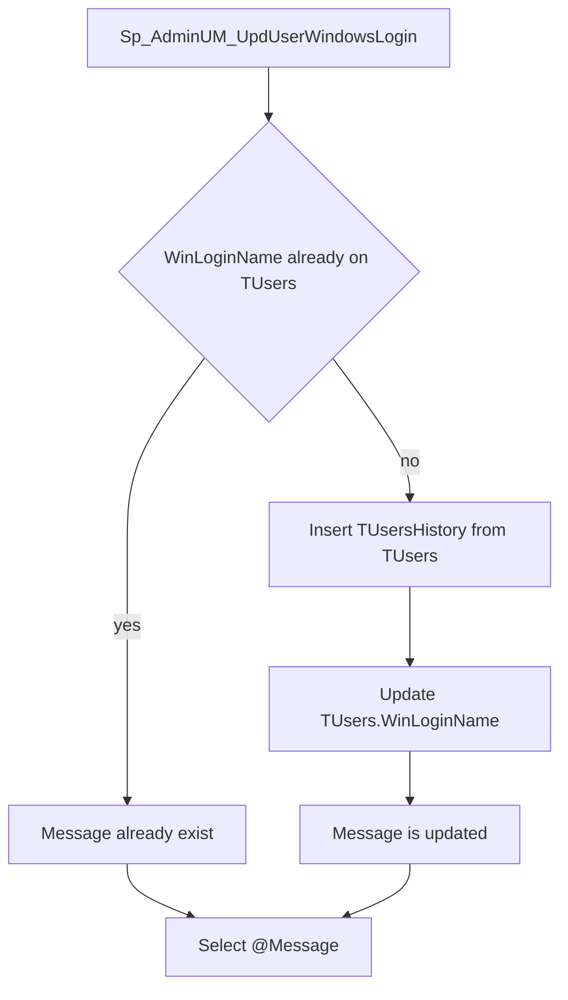

# Sp_AdminUM_UpdUserWindowsLogin

## What it does

Sets one employee’s Windows login on the linked `TUsers` row, or refuses the change when that Windows login already exists on any user. On success it copies the current user row into `TUsersHistory`, then updates `WinLoginName`, `ModifiedBy`, and `ModifiedDate`. It always returns one message string in a result set for the WebForms page to classify as duplicate or updated.

## Parameters

| Name | Direction | What it is for |
|---|---|---|
| `@EmployeeId` | in | Employee whose linked user is updated |
| `@WinLoginId` | in | New Windows / AD login value for `TUsers.WinLoginName` |
| `@UpdateBy` | in | Employee id recorded as `ModifiedBy` |

## Call sequence

Calls no other procedures or functions.

## Callers

No other procedure or function calls this object. `UserManagementDAL.UpdateUserWinLogin` executes it (constant `sp_UpdateUserWindowsLogin` maps to this name). Windows Login Setup calls that DAL method once per checked grid row with a non-empty login.

## Nested

Calls no other procedures or functions.

## Steps

1. In `HRMS-DATABASE/HRMS/STOREPROCEDURE/Sp_AdminUM_UpdUserWindowsLogin.sql`, if any `TUsers` row has `WinLoginName = @WinLoginId`, set `@Message` to `User's Window Login Id already exist.` and skip the write.
2. Otherwise resolve `UserID` from `TUserEmployee` where `EmployeeID = @EmployeeId`.
3. Insert into `TUsersHistory` (`UserID`, `UserName`, `PasswordStr`, `RoleID`, `UserEmail`, `IsActive`, `ChangedOn`, `ChangedBy`, `Employerid`) from the current `TUsers` row for that `UserID`. `ChangedOn` is `ISNULL(ModifiedDate, CreatedDate)` and `ChangedBy` is `ISNULL(ModifiedBy, CreatedBy)`.
4. Update that `TUsers` row: `WinLoginName = @WinLoginId`, `ModifiedBy = @UpdateBy`, `ModifiedDate = GETDATE()`.
5. Set `@Message` to `User's Window Login Id is updated.`
6. Select `@Message` as the sole result set.

## Tables

| Table | Read or write |
|---|---|
| `dbo.TUsers` | read and write |
| `dbo.TUserEmployee` | read |
| `dbo.TUsersHistory` | write |

## Flow

