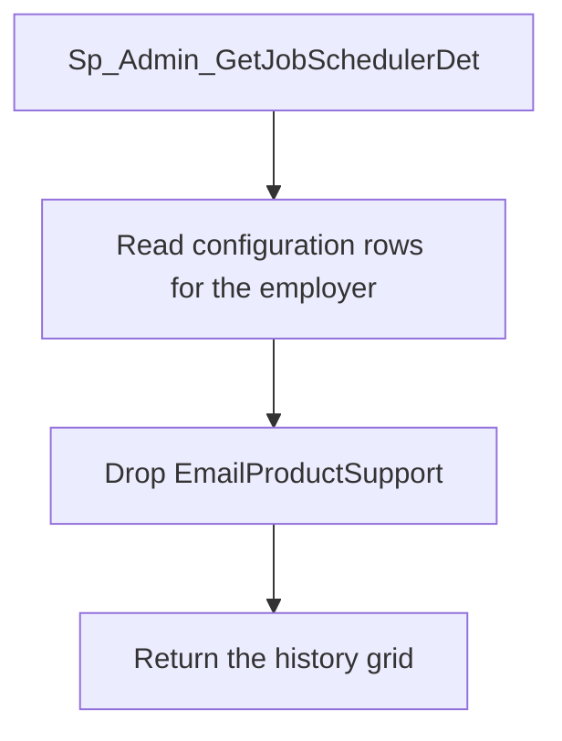

# Sp_Admin_GetJobSchedulerDet

## What it does

Returns the configuration history grid for one employer: config id, scheduler name, key, and value. Rows whose key is `EmailProductSupport` are left out.

## Parameters

| Name | Direction | What it is for |
|---|---|---|
| `@pEmployerId` | in | Organisation |

## Call sequence

Calls no other procedures or functions.

## Callers

Procedures and functions that call this object.

No other procedure or function calls this object.

## Nested

Calls no other procedures or functions.

## Steps

1. In `HRMS-DATABASE/HRMS/STOREPROCEDURE/Sp_Admin_GetJobSchedulerDet.sql`, select `ConfigId`, `SchedulerName`, `ConfigKey`, and `ConfigValue` from `TJobSchedulerConfiguration`.

2. Keep rows for `@pEmployerId` whose `ConfigKey` is not `EmailProductSupport`.

## Tables

| Table | Read or write |
|---|---|
| `TJobSchedulerConfiguration` | read |

## Flow

