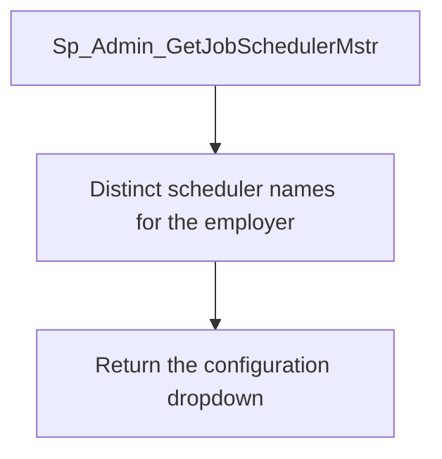

# Sp_Admin_GetJobSchedulerMstr

## What it does

Returns distinct scheduler names that already have a configuration row for one employer. The Scheduler Configuration tab binds this list to the job dropdown.

## Parameters

| Name | Direction | What it is for |
|---|---|---|
| `@pEmployerId` | in | Organisation |

## Call sequence

Calls no other procedures or functions.

## Callers

Procedures and functions that call this object.

No other procedure or function calls this object.

## Nested

Calls no other procedures or functions.

## Steps

1. In `HRMS-DATABASE/HRMS/STOREPROCEDURE/Sp_Admin_GetJobSchedulerMstr.sql`, select distinct `SchedulerName` from `TJobSchedulerConfiguration` where `EmployerId` = `@pEmployerId`.

## Tables

| Table | Read or write |
|---|---|
| `TJobSchedulerConfiguration` | read |

## Flow

