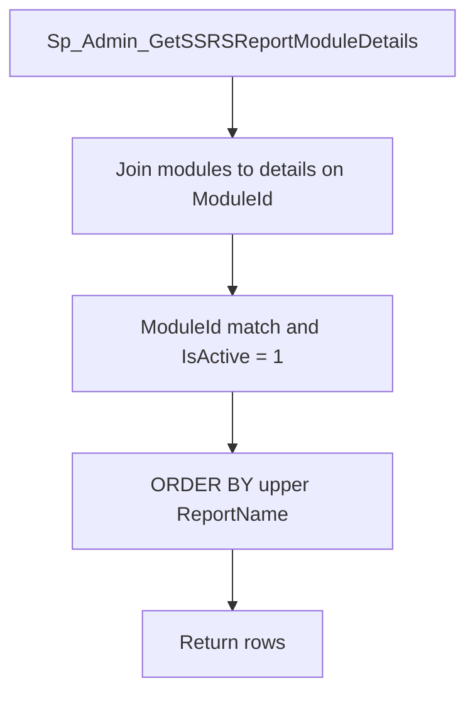

# Sp_Admin_GetSSRSReportModuleDetails

## What it does

Returns active SSRS report detail rows for one module: detail id, module id/name, report name, description, and `IsActive`. **Reports & Analytics → SSRS Reports** calls it when the user picks a module (and again when returning from the viewer with `SelectedModule`).

## Parameters

| Name | Direction | What it is for |
|---|---|---|
| `@ModuleId` | in | Module whose active reports to list |

## Call sequence

Calls no other procedures or functions.

## Callers

Procedures and functions that call this object.

No other procedure or function calls this object.

Application callers (not nested SQL): `ReportDAL.GetSSRSReportModuleDetails` → `ReportBLL.GetSSRSReportModuleDetails` → `SSRSStaticReports.getReportDetails`.

## Nested

Calls no other procedures or functions.

## Steps

1. In `HRMS-DATABASE/HRMS/STOREPROCEDURE/Sp_Admin_GetSSRSReportModuleDetails.sql`, inner-join `TMASTER_SSRSREPORTMODULES` to `TMASTER_SSRSReportDetails` on `ModuleId`.
2. Filter to `sr.ModuleId = @ModuleId` and `sd.IsActive = 1`.
3. Select `SSRSReportDetailId`, `ModuleId`, `ModuleName`, `ReportName`, `ReportDescription`, `IsActive`.
4. Order by `upper(ReportName)` ascending and return the result set.

## Tables

| Table | Read or write |
|---|---|
| `TMASTER_SSRSREPORTMODULES` | read |
| `TMASTER_SSRSReportDetails` | read |

## Unresolved calls

None.

## Flow

