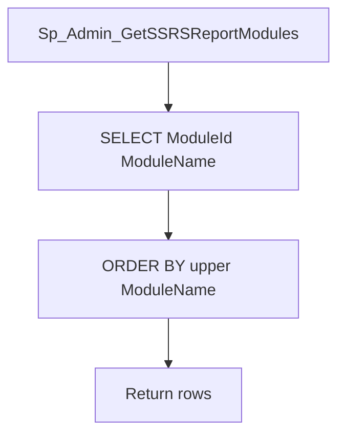

# Sp_Admin_GetSSRSReportModules

## What it does

Returns every SSRS report module (`ModuleId`, `ModuleName`) from `TMASTER_SSRSREPORTMODULES`, ordered by upper-cased module name. **Reports & Analytics → SSRS Reports** (`SSRSStaticReports.aspx`) calls it on first load to fill the module combo.

## Parameters

None.

## Call sequence

Calls no other procedures or functions.

## Callers

Procedures and functions that call this object.

No other procedure or function calls this object.

Application callers (not nested SQL): `ReportDAL.GetSSRSReportModules` → `ReportBLL.GetSSRSReportModules` → `SSRSStaticReports._getReportModuleData`.

## Nested

Calls no other procedures or functions.

## Steps

1. In `HRMS-DATABASE/HRMS/STOREPROCEDURE/Sp_Admin_GetSSRSReportModules.sql`, `SELECT` `ModuleId` and `ModuleName` from `TMASTER_SSRSREPORTMODULES`.
2. Order rows by `upper(ModuleName)` ascending.
3. Return the result set. There is no active-flag filter on the module table in this procedure.

## Tables

| Table | Read or write |
|---|---|
| `TMASTER_SSRSREPORTMODULES` | read |

## Unresolved calls

None.

## Flow

