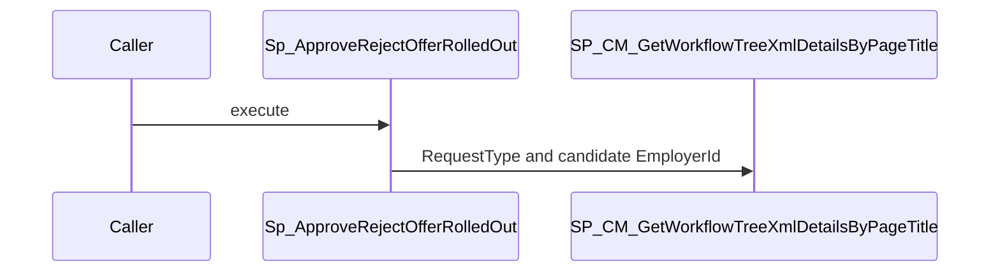
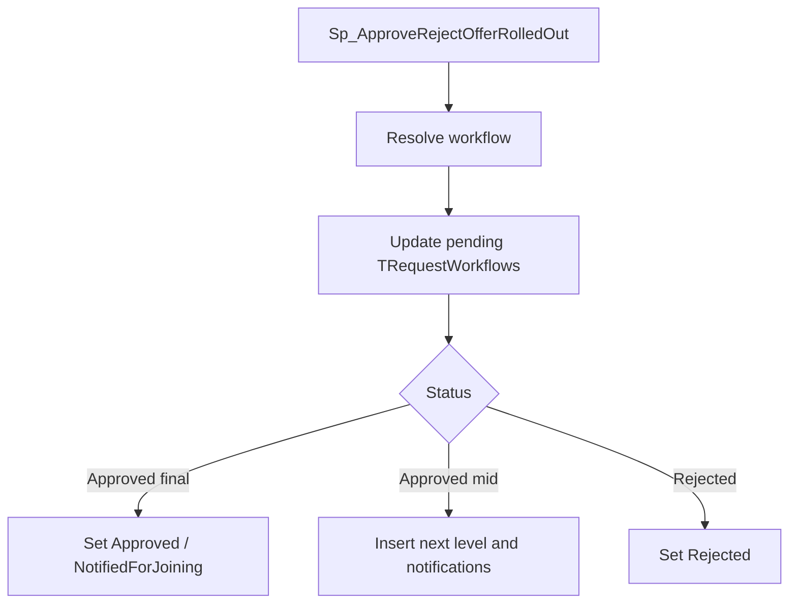

# Sp_ApproveRejectOfferRolledOut

## What it does

Applies an approve or reject decision on a DirectCandidate Offer Rolled Out workflow. Updates the pending `TRequestWorkflows` row for the candidate, then either advances to the next routing level (with notifications), finalizes approve (`TMAddCandidate` → `Approved`, `TRRSCandidate` → `NotifiedForJoining`), or rejects both masters.

## Parameters

| Name | Direction | What it is for |
|---|---|---|
| `@CandidateId` | in | Candidate / request transaction id |
| `@LoggedInUser` | in | Acting approver |
| `@EmployerId` | in | Overwritten from `TMAddCandidate.EmployerId` |
| `@RequestType` | in | Passed to workflow tree lookup (UI sends `DirectCandidate`) |
| `@Status` | in | `Approved` or `Rejected` |
| `@Comments` | in | Stored on the workflow row |

## Call sequence

## Callers

No other procedure or function calls this object.

## Nested

| Object | Kind | When | Page |
|---|---|---|---|
| `SP_CM_GetWorkflowTreeXmlDetailsByPageTitle` | procedure | always | [SP_CM_GetWorkflowTreeXmlDetailsByPageTitle](/docs/database/hrms/SP_CM_GetWorkflowTreeXmlDetailsByPageTitle) |

## Steps

1. Load `@EmployerId` (and creator) from `TMAddCandidate`.
2. Resolve workflow via `SP_CM_GetWorkflowTreeXmlDetailsByPageTitle`.
3. Compute max routing level and the logged-in user's current approval level.
4. If routing level &gt; 0: mark pending workflow rows `IsApprove = 1` with `ApproveStatus` `C` or `R`.
5. On approve: if at final level, set candidate statuses to approved / `NotifiedForJoining`; else insert next-level managers into `TRequestWorkflows` and `TEmailNotification`.
6. On reject: set `TRRSCandidate.Status` and `TMAddCandidate.CandidateStatus` to `Rejected`.

## Tables

| Table | Read or write |
|---|---|
| `TMAddCandidate` | read / write |
| `TRRSCandidate` | write |
| `TWorkflowDetails` | read |
| `TRequestWorkflows` | read / write |
| `tRoleEmployeeMapping` | read |
| `TEmailNotification` | write |

## Flow

