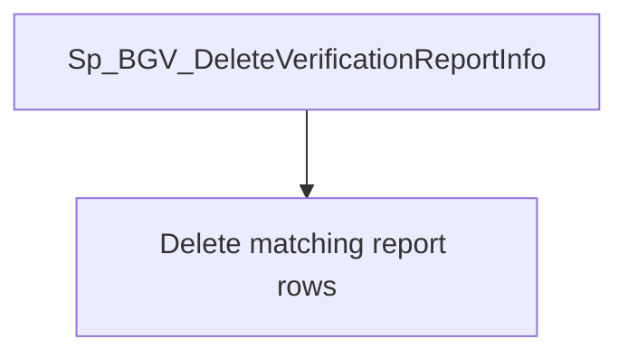

# Sp_BGV_DeleteVerificationReportInfo

## What it does

Deletes `TBGVVerificationReport` rows whose `VerRptDocGrpID` equals the supplied id.

## Parameters

| Name | Direction | What it is for |
|---|---|---|
| `@VerRptDocGrpID` | in | Report document group id to delete |

## Call sequence

Calls no other procedures or functions.

## Callers

No other procedure or function calls this object. Application caller: BGV API `bgverificationDAL.DeleteBGVBGVReport`.

## Nested

Calls no other procedures or functions.

## Steps

1. Script is `HRMS-DATABASE/HRMS/STOREPROCEDURE/Sp_BGV_DeleteVerificationReportInfo.sql`.
2. `DELETE FROM TBGVVerificationReport WHERE VerRptDocGrpID = @VerRptDocGrpID`.

## Tables

| Table | Read or write |
|---|---|
| `dbo.TBGVVerificationReport` | write |

## Flow

