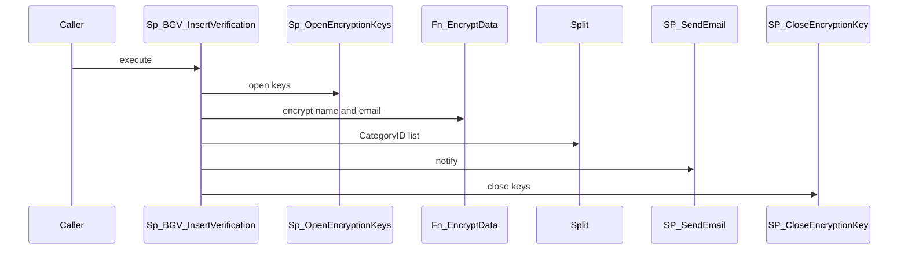
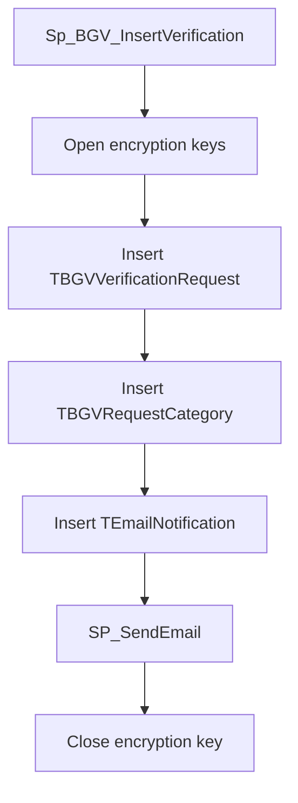

# Sp_BGV_InsertVerification

## What it does

Creates a background verification request. It opens encryption keys, inserts an encrypted name/email row into `TBGVVerificationRequest` with status **Documents Request** (`TBGVStatuslookup` for `Employerid=0`), inserts category rows into `TBGVRequestCategory` with `categoryStatus = -1`, queues a `TEmailNotification` (`PreEmpBackgroundVerification` or `PostEmpBackgroundVerification`), and calls `SP_SendEmail` with a hard-coded subject/body. Post-employment sets `PreToPostComments` to `On Board BGV`.

## Parameters

| Name | Direction | What it is for |
|---|---|---|
| `@EmployeeId` | in | Subject employee id (post) or related employee |
| `@Employerid` | in | Tenant employer |
| `@FirstName` / `@MiddleName` / `@LastName` | in | Name fields encrypted with `Fn_EncryptData` |
| `@IsPreEmpVerType` | in | `Y` pre-employment, `N` post-employment |
| `@Emailid` | in | Email encrypted with `Fn_EncryptData` |
| `@LinkValidTill` | in | Document-link validity date |
| `@Comments` | in | Free-text comments |
| `@CreatedBy` | in | Operator employee id |
| `@CategoryID` | in | Comma-separated category ids (`Split`) |
| `@CandidateId` | in | Optional RRS candidate |
| `@BusinessUnitId` | in | Optional business unit |

## Call sequence

## Callers

No other procedure or function calls this object. Application caller: BGV API `bgverificationDAL.InsertBGVRequestDetails`.

## Nested

| Object | Kind | When | Page |
|---|---|---|---|
| `Sp_OpenEncryptionKeys` | procedure | always at start | [Sp_OpenEncryptionKeys](/docs/database/hrms/Sp_OpenEncryptionKeys) |
| `Fn_EncryptData` | function | name and email columns | [Fn_EncryptData](/docs/database/hrms/Fn_EncryptData) |
| `Split` | function | parse `@CategoryID` | [Split](/docs/database/hrms/Split) |
| `SP_SendEmail` | procedure | after insert | [SP_SendEmail](/docs/database/hrms/SP_SendEmail) |
| `SP_CloseEncryptionKey` | procedure | always at end | [SP_CloseEncryptionKey](/docs/database/hrms/SP_CloseEncryptionKey) |

## Steps

1. Script is `HRMS-DATABASE/HRMS/STOREPROCEDURE/Sp_BGV_InsertVerification.sql`.
2. `Exec Sp_OpenEncryptionKeys`.
3. Branch on `@IsPreEmpVerType` for post comment text and email template type.
4. Insert `TBGVVerificationRequest` with status looked up as `Documents Request` / `Employerid=0`, encrypted PII, `DocRequestDate = Getdate()`.
5. Insert `TBGVRequestCategory` rows from `Dbo.Split(@CategoryID, ',')` with `categoryStatus = -1`.
6. Insert `TEmailNotification` pending row for pre or post template.
7. Build subject/body; resolve from/CC; `Exec SP_SendEmail`.
8. `Exec SP_CloseEncryptionKey`.

## Tables

| Table | Read or write |
|---|---|
| `dbo.TBGVStatuslookup` | read |
| `dbo.TBGVVerificationRequest` | write |
| `dbo.TBGVRequestCategory` | write |
| `dbo.TEmailNotification` | write |
| `dbo.TEmployeeInfo` | read (post employment number) |
| `dbo.TEmployerDetails` | read (sender email) |
| `dbo.TEmployee` | read (creator email) |
| `dbo.TJobSchedulerConfiguration` | read (`NotificationForBGV` CC) |

## Flow

