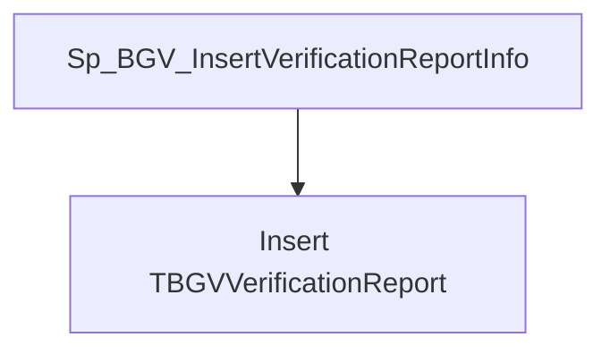

# Sp_BGV_InsertVerificationReportInfo

## What it does

Inserts one `TBGVVerificationReport` row linking a verification request to a report document group id, with `CreatedBy` and `CreatedDate`.

## Parameters

| Name | Direction | What it is for |
|---|---|---|
| `@VerificationId` | in | Parent verification request |
| `@VerRptDocGrpID` | in | Document id / group id for the report file |
| `@CreatedBy` | in | Operator employee id |

## Call sequence

Calls no other procedures or functions.

## Callers

No other procedure or function calls this object. Application caller: BGV API `bgverificationDAL.InsertBGVReport`.

## Nested

Calls no other procedures or functions.

## Steps

1. Script is `HRMS-DATABASE/HRMS/STOREPROCEDURE/Sp_BGV_InsertVerificationReportInfo.sql`.
2. Insert into `TBGVVerificationReport` with `getdate()` as `CreatedDate`.

## Tables

| Table | Read or write |
|---|---|
| `dbo.TBGVVerificationReport` | write |

## Flow

