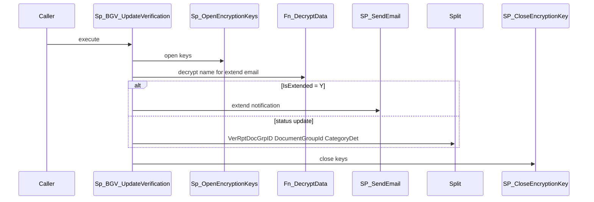
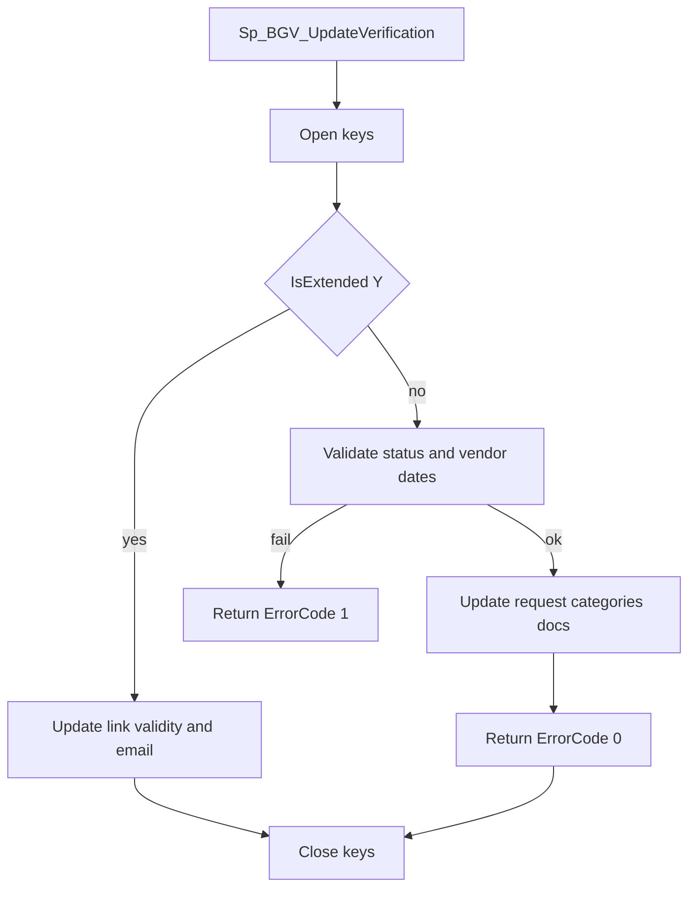

# Sp_BGV_UpdateVerification

## What it does

Updates an existing BGV request. When `@IsExtended = 'Y'` it only extends `LinkValidTill` (keeping prior value in `PreLinkValidTill`), queues a pre/post extend notification, and emails via `SP_SendEmail`. Otherwise it validates status-change and vendor dates against prior milestone dates, updates `TBGVVerificationRequest`, marks report/document group ids uploaded, and applies per-category statuses from a pipe/`~` encoded `@CategoryDet` string. Soft failures return `ErrorCode = 1` with a message; success returns `ErrorCode = 0`.

## Parameters

| Name | Direction | What it is for |
|---|---|---|
| `@VerificationId` | in | Request to update |
| `@LinkValidTill` | in | New link validity |
| `@Comments` | in | Comments |
| `@Status` | in | Next status lookup id |
| `@StatusChangeDate` | in | Date for the status change |
| `@IsExtended` | in | `Y` = extend-link branch only |
| `@UpdatedBy` | in | Operator employee id |
| `@VerResultId` | in | Optional completion result |
| `@VerRptDocGrpID` | in | Comma-separated report document ids to mark uploaded |
| `@DocumentGroupId` | in | Comma-separated document group ids to mark uploaded |
| `@VendorId` | in | Optional vendor |
| `@VendorInitiateDate` | in | Vendor start date |
| `@CategoryDet` | in | `categoryId~statusId` segments separated by `\|` |
| `@VendorRptRecievedDate` | in | Vendor report received date |

## Call sequence

## Callers

No other procedure or function calls this object. Application caller: BGV API `bgverificationDAL.UpdateBGVRequestDetails`.

## Nested

| Object | Kind | When | Page |
|---|---|---|---|
| `Sp_OpenEncryptionKeys` | procedure | always at start | [Sp_OpenEncryptionKeys](/docs/database/hrms/Sp_OpenEncryptionKeys) |
| `Fn_DecryptData` | function | name fields for email text | [Fn_DecryptData](/docs/database/hrms/Fn_DecryptData) |
| `SP_SendEmail` | procedure | when `@IsExtended = 'Y'` | [SP_SendEmail](/docs/database/hrms/SP_SendEmail) |
| `Split` | function | report/doc/category lists | [Split](/docs/database/hrms/Split) |
| `SP_CloseEncryptionKey` | procedure | success path end | [SP_CloseEncryptionKey](/docs/database/hrms/SP_CloseEncryptionKey) |

## Steps

1. Script is `HRMS-DATABASE/HRMS/STOREPROCEDURE/Sp_BGV_UpdateVerification.sql`.
2. Open keys; load current request including decrypted names.
3. If `@IsExtended = 'Y'`: update link fields, insert extend `TEmailNotification`, send email, skip status branch.
4. Else if status changed: resolve `Lookup_text`; enforce date ≥ prior milestone for Documents Received / Initiated / Partially Initiated / Completed / Stop Check / Cancel; return `ErrorCode = 1` on failure.
5. Validate vendor initiate ≥ document received and vendor report ≥ vendor initiate.
6. Update request header fields; mark `TBGVVerificationReport` / `TBGVDocumentsRequest` uploaded flags; cursor-update `TBGVRequestCategory` statuses from `@CategoryDet`.
7. Select `ErrorCode = 0`; close keys.

## Tables

| Table | Read or write |
|---|---|
| `dbo.TBGVVerificationRequest` | read/write |
| `dbo.TBGVstatuslookup` / `dbo.TBGVStatusLOOKUP` | read |
| `dbo.TEmailNotification` | write (extend) |
| `dbo.TEmployeeInfo` | read |
| `dbo.TEmployerDetails` | read |
| `dbo.TEmployee` | read |
| `dbo.TJobSchedulerConfiguration` | read |
| `dbo.TBGVVerificationReport` | write |
| `dbo.TBGVDocumentsRequest` | write |
| `dbo.TBGVRequestCategory` | write |

## Flow

