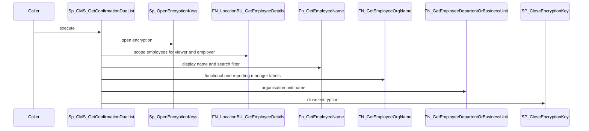
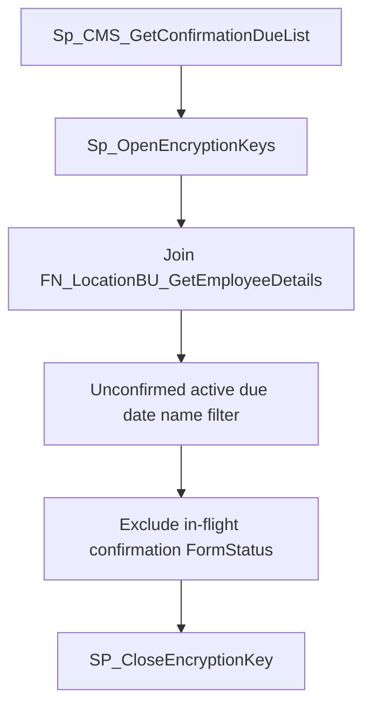

# Sp_CMS_GetConfirmationDueList

## What it does

Returns active employees for one employer who have a confirmation due date, are not yet confirmed (employment type not confirmed, `confirmationdate` null), are visible to the viewer via location/BU access, and do not already have an in-flight confirmation form (`Pending` / `Submitted` / `Approved` / `Force Close` / `Terminate`). Optional `@EmployeeName` filters by a contains match on decrypted employee name plus employment number (text before `(` if present). Used by Initiate Confirmation’s due list (`GetConfirmationDueList`), not Confirmation Due’s UI list.

## Parameters

| Name | Direction | What it is for |
|---|---|---|
| `@Employerid` | in | Employer whose employees to list |
| `@EmployeeName` | in | Search text (name and/or number); empty means no name filter beyond `LIKE '%%'` |
| `@Employeeid` | in | Viewer employee id for `FN_LocationBU_GetEmployeeDetails` scope (default `0`) |

## Call sequence

## Callers

No other procedure or function calls this object. Application callers include Core API `performanceAssessmentDAL.GetConfirmationDueList`.

## Nested

| Object | Kind | When | Page |
|---|---|---|---|
| `Sp_OpenEncryptionKeys` | procedure | always, before select | [Sp_OpenEncryptionKeys](/docs/database/hrms/Sp_OpenEncryptionKeys) |
| `SP_CloseEncryptionKey` | procedure | always, after select | [SP_CloseEncryptionKey](/docs/database/hrms/SP_CloseEncryptionKey) |
| `FN_LocationBU_GetEmployeeDetails` | function | join scope | [FN_LocationBU_GetEmployeeDetails](/docs/database/hrms/FN_LocationBU_GetEmployeeDetails) |
| `Fn_GetEmployeeName` | function | select and name filter | [Fn_GetEmployeeName](/docs/database/hrms/Fn_GetEmployeeName) |
| `FN_GetEmployeeOrgName` | function | manager columns | [FN_GetEmployeeOrgName](/docs/database/hrms/FN_GetEmployeeOrgName) |
| `FN_GetEmployeeDepartentOrBusinessUnit` | function | organisation unit OUTER APPLY | [FN_GetEmployeeDepartentOrBusinessUnit](/docs/database/hrms/FN_GetEmployeeDepartentOrBusinessUnit) |

## Steps

Script: `HRMS-DATABASE/HRMS/STOREPROCEDURE/Sp_CMS_GetConfirmationDueList.sql`.

1. Open encryption keys.
2. Compute `@Index` as characters before `(` in `@EmployeeName`, or full length when none.
3. Select employee rows from `TPMSEmployerConfiguration` / `TEmployee` / `TEmployeeInfo` / `TEmployerDetails`, scoped by `FN_LocationBU_GetEmployeeDetails`, with BU name, locations, managers, designation, latest confirmation metadata, HR comments, allow-initiate flag, derived `ConfEmpStatus`, employment type, and Active / Active-Resigned / InActive `EmpStatus` (resignation OUTER APPLY).
4. Filter unconfirmed employment type, null confirmation date, active employee, non-null due date, name `LIKE`, and exclude employees with blocking `TCMSEmployeeConfirmation.FormStatus` values.
5. Order by `EmployeeId` descending; close encryption keys.

## Tables

| Table | Read or write |
|---|---|
| `TPMSEmployerConfiguration` | read |
| `TEmployee` | read |
| `TEmployeeInfo` | read |
| `TEmployerDetails` | read |
| `TCMSEmployeeConfirmation` | read |
| `TPMSEmpConfirmationHRComments` | read |
| `TPMSEmpConfirmationStatus` | read |
| `TMEmploymentTypes` | read |
| `TLocation` | read |
| `TTitle` | read |
| `TORGChart` | read |
| `tResignationDetails` | read |
| `TSeparationType` | read |
| `TRequestWorkflows` | read |

## Flow

