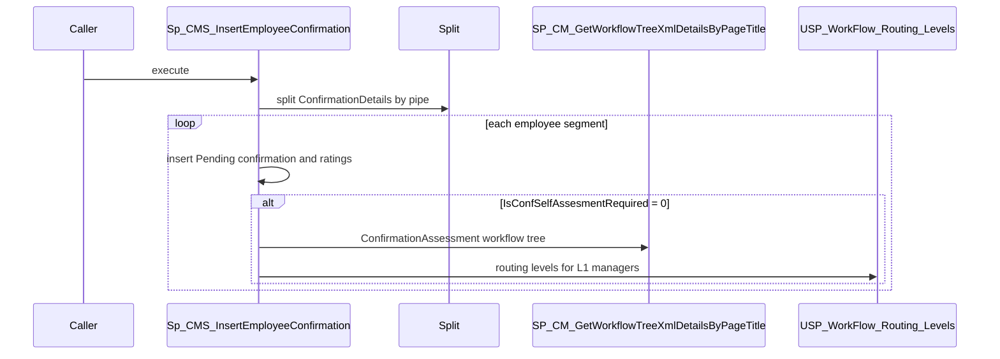
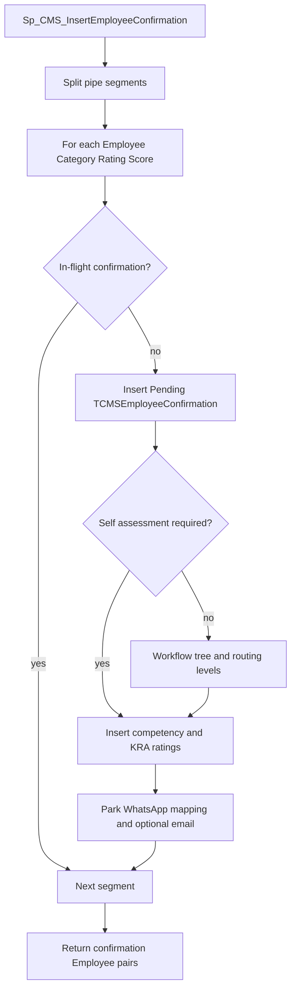

# Sp_CMS_InsertEmployeeConfirmation

## What it does

Parses pipe-delimited confirmation detail segments (`EmployeeID~CategoryId~RatingScaleId~ScoreMethod`), and for each employee with no in-flight Pending/Submitted/Approved confirmation inserts a `TCMSEmployeeConfirmation` row (`FormStatus = 'Pending'`), seeds `TCMSEmployeeCompetencyRatings` from category competencies and KRAs, optionally resolves ConfirmationAssessment workflow managers when self-assessment is off, parks WhatsApp assessment mapping, and queues a ConfirmationManagement email notification when configured. Returns the initiated confirmation id / employee id pairs. Used by Initiate Confirmation Submit.

## Parameters

| Name | Direction | What it is for |
|---|---|---|
| `@ConfirmationDetails` | in | Pipe-separated segments; each segment `EmployeeID~CategoryId~RatingScaleId~ScoreMethod` |
| `@CreatedBy` | in | Employee id recorded as creator on confirmation and park rows |

## Call sequence

## Callers

Procedures and functions that call this object.

| Object | Kind | Page |
|---|---|---|
| `Sp_AdminCMS_InsertAutoEmployeeConfirmation` | procedure | No page yet |

Application callers include Core API `performanceAssessmentDAL.InsertCMSEmployeeConfirmation`.

## Nested

| Object | Kind | When | Page |
|---|---|---|---|
| `Split` | function | always — split `@ConfirmationDetails` by `\|` | [Split](/docs/database/hrms/Split) |
| `SP_CM_GetWorkflowTreeXmlDetailsByPageTitle` | procedure | when `IsConfSelfAssesmentRequired = 0` | [SP_CM_GetWorkflowTreeXmlDetailsByPageTitle](/docs/database/hrms/SP_CM_GetWorkflowTreeXmlDetailsByPageTitle) |
| `USP_WorkFlow_Routing_Levels` | procedure | when `IsConfSelfAssesmentRequired = 0` after workflow id resolved | [USP_WorkFlow_Routing_Levels](/docs/database/hrms/USP_WorkFlow_Routing_Levels) |

## Steps

Script: `HRMS-DATABASE/HRMS/STOREPROCEDURE/Sp_CMS_InsertEmployeeConfirmation.sql`.

1. Split `@ConfirmationDetails` on `|` into a table variable; open a cursor over segments.
2. For each segment, parse employee id, category id, rating scale id, and score method.
3. Skip insert when the employee already has Pending / Submitted / Approved confirmation.
4. Read functional / reporting / review / BU-head managers; insert `TCMSEmployeeConfirmation` as Pending with score method and manager snapshots.
5. Read `TPMSEmployerConfiguration` for self-assessment and notify flags.
6. When self-assessment is off, load ConfirmationAssessment workflow tree and routing levels into `#Managers`; set L1 `managerId`.
7. Insert competency and KRA rating seed rows into `TCMSEmployeeCompetencyRatings` (manager id is employee when self-assessment on, else L1).
8. When self-assessment is off, insert `TRequestWorkflows` L1 pending row, set `IsDirectToManager = 1`, park WhatsApp mapping with manager; else set `IsDirectToManager = 0` and park self mapping.
9. When notify-on-initiation is on and a ConfirmationManagement notification template exists, insert `TEmailNotification`.
10. Collect confirmation id / employee id pairs and return them after the cursor closes.

## Tables

| Table | Read or write |
|---|---|
| `TCMSEmployeeConfirmation` | read and write |
| `TEmployeeInfo` | read |
| `TORGChart` | read |
| `TEmployeeOrgBusinessHead` | read |
| `TEmployee` | read |
| `TPMSEmployerConfiguration` | read |
| `TCMSEmployeeCompetencyRatings` | write |
| `TPMSCategoryCompetencies` | read |
| `TPMSCategorySections` | read |
| `TPMSCategoryGoalKRAs` | read |
| `TRequestWorkflows` | write |
| `TPMS_ParkWhatsAppAssessmentMapping` | write |
| `TEmailTemplates` | read |
| `TModulePages` | read |
| `TEmailNotification` | write |

## Flow

