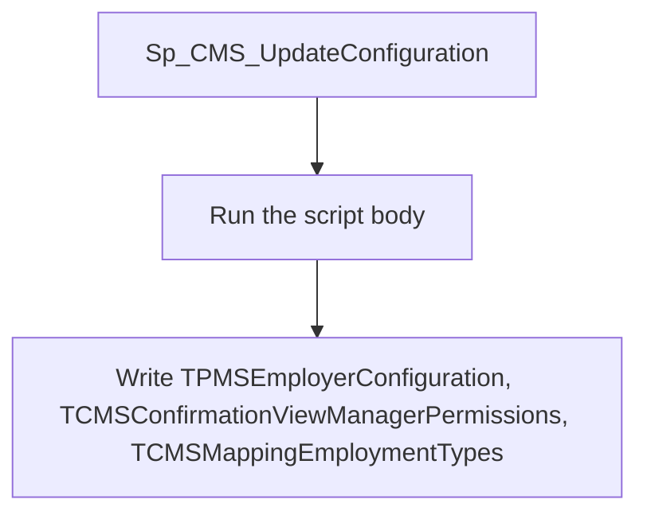

# Sp_CMS_UpdateConfiguration

## What it does

Saves the employer confirmation-configuration flags, the levels that may view a confirmation, and the non-confirmed to confirmed employment-type pairs.

## Parameters

| Name | Direction | What it is for |
|---|---|---|
| `@EmployerId` | in | Employer Id |
| `@ConfirmationDueDays` | in | Confirmation Due Days. Default 0 |
| `@IsAllowedForDecimalRatingsCMS` | in | Is Allowed For Decimal Ratings CMS. Default 0 |
| `@IsAutomaticConfirmationLetter` | in | Is Automatic Confirmation Letter. Default 0 |
| `@IsConfSelfAssesmentRequired` | in | Is Conf Self Assesment Required. Default 1 |
| `@IsAutomaticConfirmation` | in | Is Automatic Confirmation. Default 0 |
| `@AutoConfInitiationDueDays` | in | Auto Conf Initiation Due Days. Default 0 |
| `@ApprovalWorkFlowForDocGenaration` | in | Approval Work Flow For Doc Genaration. Default 0 |
| `@IsConfViewHRComments` | in | Is Conf View HRComments. Default 0 |
| `@IsAllowAutoSaveChangesForCMS` | in | Is Allow Auto Save Changes For CMS. Default 0 |
| `@UDTAppraisalViewManagerPermissions` | in | UDTAppraisal View Manager Permissions. Table-valued parameter |
| `@IsConfAutoEmploymentType` | in | Is Conf Auto Employment Type. Default 0 |
| `@UDTCMSMappingEmploymentTypes` | in | UDTCMSMapping Employment Types. Table-valued parameter |
| `@IsPersonalDataToShowCMS` | in | Is Personal Data To Show CMS. Default 1 |
| `@IsNotifyConfInitiation` | in | Is Notify Conf Initiation. Default 1 |
| `@IsExtendConfToNextLevel` | in | Is Extend Conf To Next Level. Default 1 |
| `@UDTAssessmentCommentPermissions` | in | UDTAssessment Comment Permissions. Table-valued parameter |
| `@UDTAssessmentRatingPermissions` | in | UDTAssessment Rating Permissions. Table-valued parameter |
| `@IsBypassExtendedForm` | in | Is Bypass Extended Form. Default 0 |
| `@IsShowConfTeamAssessmentForEmployeeRole` | in | Is Show Conf Team Assessment For Employee Role. Default 1 |
| `@IsEnableKRAAchievedTargetForCMS` | in | Is Enable KRAAchieved Target For CMS. Default 0 |
| `@EnableAutoCalForMeasureForCMS` | in | Enable Auto Cal For Measure For CMS. Default 0 |
| `@IsDisableKRAEmptyFieldsCMS` | in | Is Disable KRAEmpty Fields CMS. Default 0 |
| `@IsEnableActiveResignedEmployeesForCMS` | in | Is Enable Active Resigned Employees For CMS. Default 0 |
| `@IsCMSFinalScoreDisplayFormat` | in | Is CMSFinal Score Display Format. Default 'B' |
| `@IsRevisionConfFormByLastLevelOnExtension` | in | Is Revision Conf Form By Last Level On Extension. Default 0 |
| `@IsAutoConfFormMappingExist` | in | Is Auto Conf Form Mapping Exist. Default 0 |

## Call sequence

Calls no other procedures or functions.

## Callers

No other procedure or function calls this object.

## Nested

Calls no other procedures or functions.

## Steps

Script: `HRMS-DATABASE/HRMS/STOREPROCEDURE/Sp_CMS_UpdateConfiguration.sql`.

1. select @lv_IsAllowDecimalRatings=IsAllowedForDecimalRatingsCMS,@lv_IsConfSelfAssesmentRequired=IsConfSelfAssesmentRequired from TPMSEmployerConfiguration WHERE Employerid=@Employer
2. if(@lv_IsAllowDecimalRatings!=@IsAllowedForDecimalRatingsCMS)
3. if((select count(*) from tcmsemployeeconfirmation c, temployee e where c.employeeid=e.employeeid and scoremethod='R' and FormStatus !='Approved' and EmployerID =@EmployerId)>0)
4. Select 1 ErrorCode,'IsAllowedForDecimalRatingsCMS cannot be changed it is already in used.' ErrorMsg
5. Return
6. if(@lv_IsConfSelfAssesmentRequired!=@IsConfSelfAssesmentRequired)
7. if((select count(*) from tcmsemployeeconfirmation c, temployee e where c.employeeid=e.employeeid and FormStatus in ('Pending', 'Submitted') and EmployerID =@EmployerId)>0)
8. Select 1 ErrorCode,'Self Assesment Required Flag cannot be changed it is already in used.' ErrorMsg
9. Return
10. if((select count(*) from @UDTCMSMappingEmploymentTypes)=0 AND @IsConfAutoEmploymentType =1)
11. UPDATE TPMSEmployerConfiguration
12. Delete TCMSConfirmationViewManagerPermissions Where Employerid=@EmployerId

## Tables

| Table | Read or write |
|---|---|
| `TPMSEmployerConfiguration` | read/write |
| `TCMSConfirmationViewManagerPermissions` | write |
| `TCMSMappingEmploymentTypes` | write |
| `TCMSEmployeeConfirmation` | read |

## Flow

