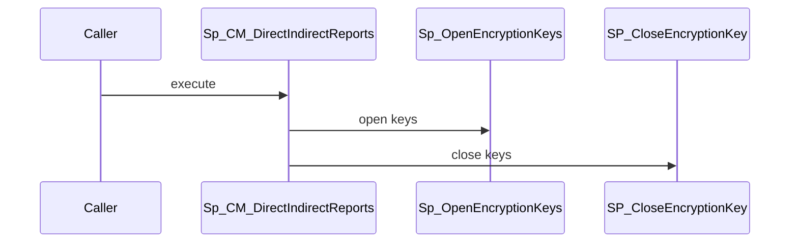
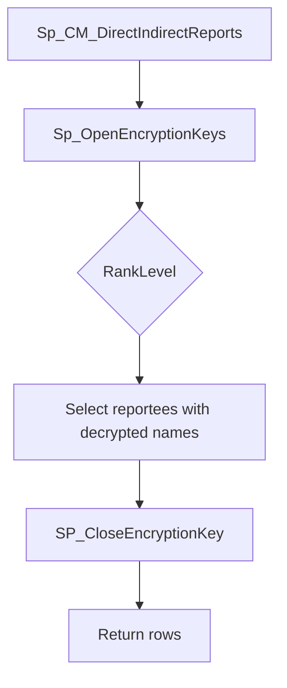

# Sp_CM_DirectIndirectReports

## What it does

Returns an employee’s reporting hierarchy roster: self, direct reportees, indirect reportees, both, or (for some HR/Admin roles) a broader employee set, depending on `@RankLevel`. Opens encryption keys so name fields can be decrypted. Feedback360 calls it with `@RankLevel = 0` and `@IsActive = 'Y'` for the Direct Report reviewer picker (callers must drop the self row that the legacy My Reporting screen keeps highlighted).

## Parameters

| Name | Direction | What it is for |
|---|---|---|
| `@EmployeeId` | in | Root employee whose reportees are listed |
| `@RankLevel` | in | `-1` self, `0` direct, `1` indirect, `-2` direct+indirect, `-3` HR/Admin all-employees style |
| `@IsActive` | in | `Y` / `N` / NULL (both); empty string treated as NULL |
| `@EmployerId` | in | Optional employer scope; defaults from `TEmployee` when NULL |

## Call sequence

## Callers

Application caller: Core API `Feedback360DAL.GetDirectReportees` for Performance Assessment → 360° Feedback. Also used by My Details / My Reporting and other CM helpers.

| Object | Kind | Page |
|---|---|---|
| _(application)_ | Core API | [360° Feedback guide](/docs/guides/performance-assessment/360-feedback) |

## Nested

| Object | Kind | When | Page |
|---|---|---|---|
| `Sp_OpenEncryptionKeys` | procedure | start of batch | [Sp_OpenEncryptionKeys](/docs/database/hrms/Sp_OpenEncryptionKeys) |
| `SP_CloseEncryptionKey` | procedure | end of batch | [SP_CloseEncryptionKey](/docs/database/hrms/SP_CloseEncryptionKey) |

Also uses functions such as `Fn_DecryptData`, `FN_GetEmployeeOrgName`, `FN_GetEmployeeDepartentOrBusinessUnit`, and `FN_LocationBU_GetAllActiveInActive_EmployeeDetails` (not separate procedure pages).

## Steps

1. Open encryption keys.
2. Resolve employer id.
3. Walk hierarchy tables into temp hierarchy collections based on `@RankLevel`.
4. Select employee identity, decrypted names, org label, designation, status, and business unit.
5. Close encryption keys.
6. Script path: `HRMS-DATABASE/HRMS/STOREPROCEDURE/Sp_CM_DirectIndirectReports.sql`.

## Tables

| Table | Read or write |
|---|---|
| `dbo.TEmployee` | read |
| `dbo.TEmployeeInfo` | read |
| Reporting / hierarchy sources used by the rank walk | read |

## Flow

