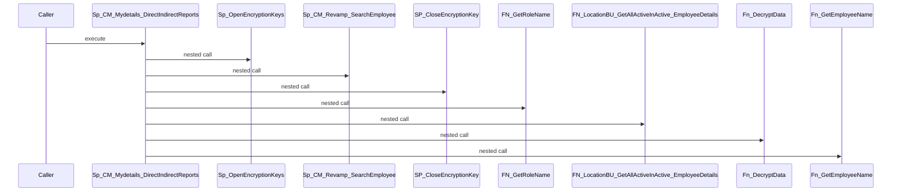
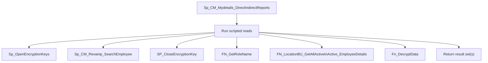

# Sp_CM_Mydetails_DirectIndirectReports

## What it does

Nested reportee / org employee set builder used by most SP_LeaveAttendanceGet*_Compact charts.

## Parameters

| Name | Direction | What it is for |
|---|---|---|
| `@EmployeeId` | in | `INT` |
| `@RankLevel` | in | `INT` |
| `@IsActive` | in | `CHAR(1)` |
| `@EmployerId` | in | `VARCHAR(MAX)` |
| `@FiltersJson` | in | `NVARCHAR(MAX)` |
| `@IsSearch` | in | `char(1)` |

## Call sequence

## Callers

No other procedure or function calls this object. Most `SP_LeaveAttendanceGet*_Compact` chart procedures executes it.

## Nested

| Object | Kind | When | Page |
|---|---|---|---|
| `Sp_OpenEncryptionKeys` | procedure | when reached in script | [Sp_OpenEncryptionKeys](/docs/database/hrms/Sp_OpenEncryptionKeys) |
| `Sp_CM_Revamp_SearchEmployee` | procedure | when reached in script | No page yet |
| `SP_CloseEncryptionKey` | procedure | when reached in script | [SP_CloseEncryptionKey](/docs/database/hrms/SP_CloseEncryptionKey) |
| `FN_GetRoleName` | function | when reached in script | [FN_GetRoleName](/docs/database/hrms/FN_GetRoleName) |
| `FN_LocationBU_GetAllActiveInActive_EmployeeDetails` | function | when reached in script | [FN_LocationBU_GetAllActiveInActive_EmployeeDetails](/docs/database/hrms/FN_LocationBU_GetAllActiveInActive_EmployeeDetails) |
| `Fn_DecryptData` | function | when reached in script | [Fn_DecryptData](/docs/database/hrms/Fn_DecryptData) |
| `Fn_GetEmployeeName` | function | when reached in script | [Fn_GetEmployeeName](/docs/database/hrms/Fn_GetEmployeeName) |

## Steps

1. In `HRMS-DATABASE/HRMS/STOREPROCEDURE/Sp_CM_Mydetails_DirectIndirectReports.sql`, accept the declared parameters and set `NOCOUNT` / read-uncommitted as scripted.
2. Build filter / reportee temp sets when the script calls nested helpers.
3. Aggregate leave/attendance (or tab ACL) rows and return the chart or card result set(s).

## Tables

| Table | Read or write |
|---|---|
| `dbo.SYS` | read |
| `dbo.TEmployee` | read |
| `dbo.STRING_SPLIT` | read |
| `dbo.OPENJSON` | read |
| `dbo.TUsers` | read |
| `dbo.TUserEmployee` | read |
| `dbo.TORGChart` | read |
| `dbo.TEmployeeInfo` | read |
| `dbo.curBuild` | read |
| `dbo.TEmployeeSkillDetails` | read |
| `dbo.TEmployeeDomainDetails` | read |
| `dbo.TEmployeeVisaInfo` | read |
| `dbo.TCOUNTRY` | read |
| `dbo.TCertificationDetails` | read |
| `dbo.TEducationDetails` | read |
| `dbo.TEmployeePassportDetails` | read |
| `dbo.TGender` | read |
| `dbo.tEmployerDetails` | read |
| `dbo.TTitle` | read |
| `dbo.tCustomerSettings` | read |
| `dbo.TEmployerCustomFields` | read |
| `dbo.TOrgHierarchyDetails` | read |

## Flow

