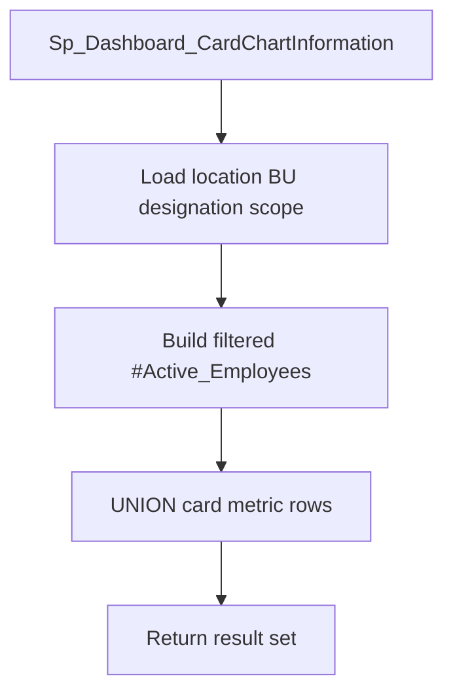

# Sp_Dashboard_CardChartInformation

## What it does

Builds the Employee Dashboard summary cards for one employer and login. It scopes work locations, business units, and designations the caller can see, filters the workforce by optional attribute and date parameters, then returns one result set of named metrics (`Name` / `Value` plus optional sub-values) such as total active employees, gender counts, on leave, work from home, new hires, employees leaving today, and average age/tenure parts.

## Parameters

| Name | Direction | What it is for |
|---|---|---|
| `@LoginID` | in | Logged-in employee used for location and BU scope |
| `@EmployerID` | in | Employer whose workforce is aggregated |
| `@BusinessUnitID` | in | Optional comma-separated business unit filter |
| `@BaseLocationID` | in | Optional base location ids |
| `@WorkLocationID` | in | Optional work location ids |
| `@Gender` | in | Optional gender filter values |
| `@AgeRange` | in | Optional age-range labels |
| `@DesignationID` | in | Optional designation ids |
| `@EmploymentTypeID` | in | Optional employment type ids |
| `@RoleID` | in | Optional employee role ids |
| `@SkillID` | in | Optional skill ids |
| `@DomainID` | in | Optional domain ids |
| `@ExperienceRange` | in | Optional company-experience labels |
| `@WorkForceStatus` | in | Active / InActive / OnNotice (null treated as Active path) |
| `@DOJ_FromDate` | in | Optional DOJ range start |
| `@DOJ_ToDate` | in | Optional DOJ range end |
| `@LWD_FromDate` | in | Optional last-working-date range start |
| `@LWD_ToDate` | in | Optional last-working-date range end |

## Call sequence

```mermaid
sequenceDiagram
  participant Caller
  participant Main as Sp_Dashboard_CardChartInformation
  participant Loc as SP_EmployeeDashboard_GetLocationByEmployeeId
  participant Bu as SP_EmployeeDashboard_GetBusinessUnitByOrg_EmployeeId
  participant Title as SP_CM_GetTitle
  Caller->>Main: execute
  Main->>Loc: load @WorkLocation
  Main->>Bu: load @BusinessUnit
  Main->>Title: load @Designation
  Main->>Main: build filtered workforce and card SELECTs
```

## Callers

| Object | Kind | Page |
|---|---|---|
| `EmployeeRepository.getCardsData` | app | [Employee Dashboard](/docs/guides/employee-management/employee-dashboard) |

No other procedure in `STOREPROCEDURE/` executes it.

## Nested

| Object | Kind | When | Page |
|---|---|---|---|
| `SP_EmployeeDashboard_GetLocationByEmployeeId` | procedure | always at start | [SP_EmployeeDashboard_GetLocationByEmployeeId](/docs/database/hrms/SP_EmployeeDashboard_GetLocationByEmployeeId) |
| `SP_EmployeeDashboard_GetBusinessUnitByOrg_EmployeeId` | procedure | always at start | [SP_EmployeeDashboard_GetBusinessUnitByOrg_EmployeeId](/docs/database/hrms/SP_EmployeeDashboard_GetBusinessUnitByOrg_EmployeeId) |
| `SP_CM_GetTitle` | procedure | always at start | [SP_CM_GetTitle](/docs/database/hrms/SP_CM_GetTitle) |

## Steps

From `HRMS-DATABASE/HRMS/STOREPROCEDURE/Sp_Dashboard_CardChartInformation.sql`:

1. EXEC location, business-unit, and title helpers into table variables.
2. Build employment-type, domain, skill, resignation, experience, and age-range temp sets for `@EmployerID`.
3. Populate `#Active_Employees` for Active, InActive, or OnNotice according to `@WorkForceStatus`, applying the optional filters.
4. Derive leave / check-in helper temps from attendance tables where used by cards.
5. UNION card rows (headcount, gender, on leave, WFH, new hires, leavers, average age/tenure parts) and return that result set.

## Tables

| Table | Read or write |
|---|---|
| `dbo.TEmployee` | read |
| `dbo.TEmployeeInfo` | read |
| `dbo.TGender` | read |
| `dbo.TMEmploymentTypes` | read |
| `dbo.TEmploymentTypeClubWith` | read |
| `dbo.TEmployeeDomainDetails` | read |
| `dbo.TSkillDomainMaster` | read |
| `dbo.TEmployeeSkillDetails` | read |
| `dbo.TMSkills` | read |
| `dbo.TEmployeeRoleMaster` | read |
| `dbo.TResignationDetails` | read |
| `dbo.TResignation` | read |
| `dbo.TDailyRegisterNew` | read |
| `dbo.TAttendanceTransaction` | read |
| `dbo.TWorkFromHomeRequest` | read |

Location, BU, and title rows come from the nested procedures (those pages list their tables).

## Unresolved calls

None.

## Flow


