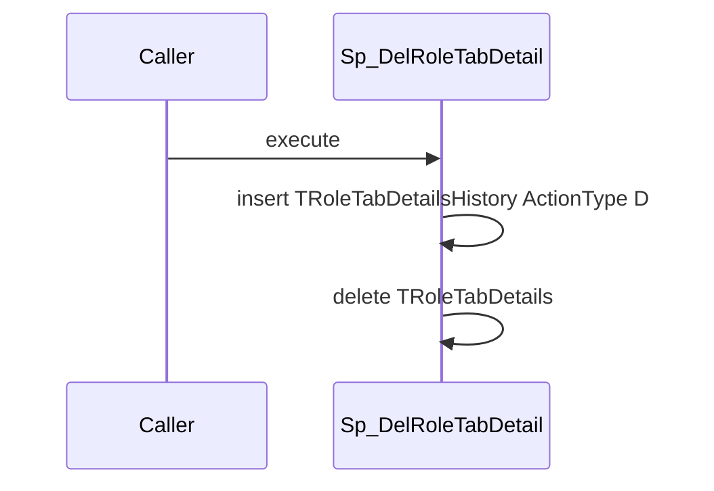
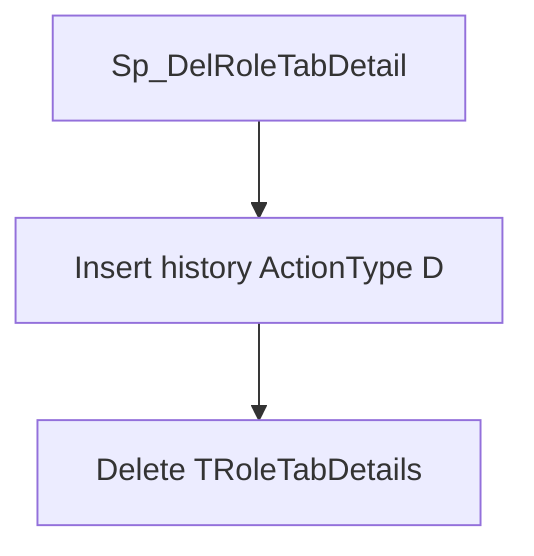

# Sp_DelRoleTabDetail

## What it does

Revokes a role's access to one tab on one menu for one employer. It copies the matching `TRoleTabDetails` row into `TRoleTabDetailsHistory` with `ActionType` `D`, then deletes the live row. It does not touch `TRolePagesMapping`.

## Parameters

| Name | Direction | What it is for |
|---|---|---|
| `@RoleId` | in | Role losing the tab |
| `@MenuId` | in | Menu (page) that owns the tab |
| `@TabId` | in | Base-organisation tab id |
| `@EmployerId` | in | Employer for the revoke |
| `@ModifiedBy` | in | Actor stamped on the history row |

## Call sequence

## Callers

No other procedure or function calls this object. `MenuManagerDAL.deleteRoleTabAccess` executes it from Tab Manager save (`POST /api/menuManagement/tabAccess`).

## Nested

Calls no other procedures or functions.

## Steps

1. In `HRMS-DATABASE/HRMS/STOREPROCEDURE/Sp_DelRoleTabDetail.sql`, compute the next `TransId` as `max(TransId)+1` from `TRoleTabDetailsHistory`.
2. Insert history from the matching `TRoleTabDetails` row with `ActionType` `D` and `@ModifiedBy`.
3. Delete the matching `TRoleTabDetails` row.

## Tables

| Table | Read or write |
|---|---|
| `dbo.TRoleTabDetails` | read, write |
| `dbo.TRoleTabDetailsHistory` | read, write |

## Unresolved calls

None.

## Flow

