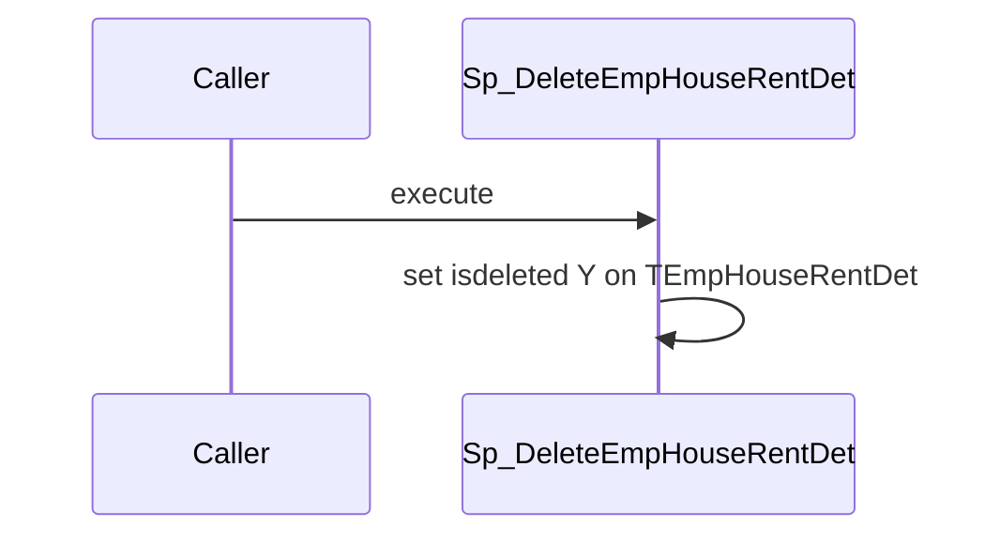
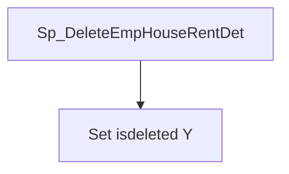

# Sp_DeleteEmpHouseRentDet

## What it does

Soft-deletes one `TEmpHouseRentDet` row by setting `isdeleted = 'Y'` for the given key. Used when the Investment Declaration UI turns that section off after it already had a saved id.

## Parameters

| Name | Direction | What it is for |
|---|---|---|
| `@HouseRentId` | in | Row key to soft-delete |

## Call sequence

Calls no other procedures or functions.

## Callers

No other procedure or function calls this object. Application caller: Core Node `IncomeTaxDeclarationDAL` update helpers when the matching section is inactive but an id already exists. `SP_EC_DeleteEmployee` deletes from `TEmpHouseRentDet` directly rather than executing this procedure.

## Nested

Calls no other procedures or functions.

## Steps

1. Script is `HRMS-DATABASE/HRMS/STOREPROCEDURE/Sp_DeleteEmpHouseRentDet.sql`.
2. Update `TEmpHouseRentDet` set `isdeleted = 'Y'` where `HouseRentId` equals `@HouseRentId`.

## Tables

| Table | Read or write |
|---|---|
| `dbo.TEmpHouseRentDet` | write |

## Flow

