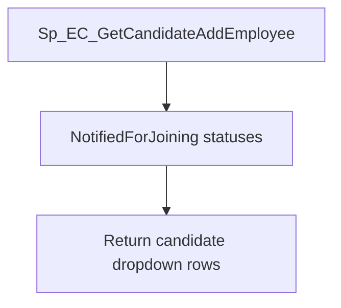

# Sp_EC_GetCandidateAddEmployee

## What it does

Returns RRS candidates eligible for the Add Employee / BGV pre-employment dropdown: status `NotifiedForJoining` or `RevisedNotifiedForJoining` for the employer. Each row includes `CandidateNumber`, `CandidateId`, and a `CandidateName` of `CandidateNumber-FirstName LastName`.

## Parameters

| Name | Direction | What it is for |
|---|---|---|
| `@Employerid` | in | Employer whose candidates are listed |

## Call sequence

Calls no other procedures or functions.

## Callers

No other procedure or function calls this object. Application caller: BGV API `employeeDAL.GetRrsCandidateAddEmployee`.

## Nested

Calls no other procedures or functions.

## Steps

1. Script is `HRMS-DATABASE/HRMS/STOREPROCEDURE/Sp_EC_GetCandidateAddEmployee.sql`.
2. Select from `trrscandidate` filtered by employer and the two joining-notified statuses.
3. Build `CandidateName` with `CONCAT`.

## Tables

| Table | Read or write |
|---|---|
| `dbo.trrscandidate` | read |

## Flow

