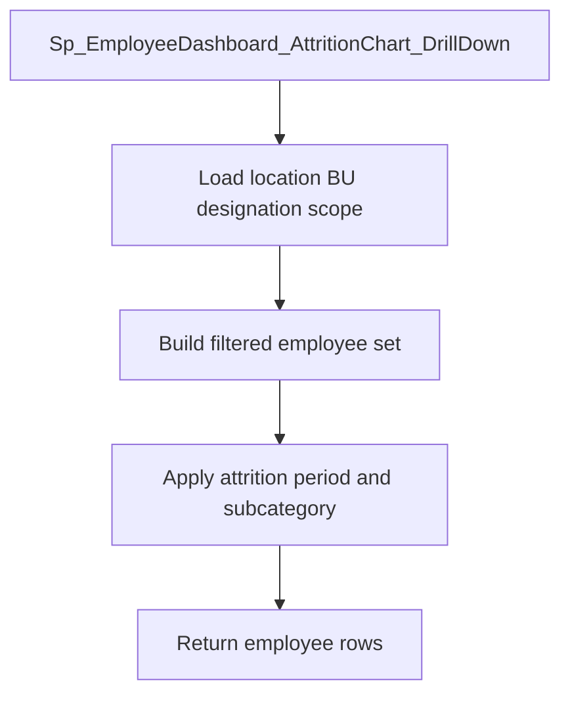

# Sp_EmployeeDashboard_AttritionChart_DrillDown

## What it does

Returns employee detail rows for an Attrition Trend chart slice. The Core API chooses this procedure when `/employees/GetDrillDownData` receives `category === "Attrition Trend"`. It scopes locations, business units, and designations, applies the shared attribute filters, then limits to the attrition period / subcategory requested by the chart.

## Parameters

| Name | Direction | What it is for |
|---|---|---|
| `@EmployeeID` | in | Logged-in employee used for location and BU scope |
| `@EmployerID` | in | Employer whose attrition slice is listed |
| `@fromDate` | in | Attrition window start |
| `@toDate` | in | Attrition window end |
| `@BusinessUnitID` | in | Optional business unit filter |
| `@BaseLocationID` | in | Optional base location ids |
| `@WorkLocationID` | in | Optional work location ids |
| `@Gender` | in | Optional gender filter |
| `@AgeRange` | in | Optional age-range labels |
| `@DesignationID` | in | Optional designation ids |
| `@EmploymentTypeID` | in | Optional employment type ids |
| `@RoleID` | in | Optional role ids |
| `@SkillID` | in | Optional skill ids |
| `@DomainID` | in | Optional domain ids |
| `@ExperienceRange` | in | Optional experience labels |
| `@WorkForceStatus` | in | Workforce status filter |
| `@DOJ_FromDate` | in | Optional DOJ range start |
| `@DOJ_ToDate` | in | Optional DOJ range end |
| `@LWD_FromDate` | in | Optional LWD range start |
| `@LWD_ToDate` | in | Optional LWD range end |
| `@CategoryName` | in | Expected Attrition Trend |
| `@SubCategoryName` | in | Period or slice label from the chart |
| `@Type` | in | Usually `chart` |

## Call sequence

```mermaid
sequenceDiagram
  participant Caller
  participant Main as Sp_EmployeeDashboard_AttritionChart_DrillDown
  participant Loc as SP_EmployeeDashboard_GetLocationByEmployeeId
  participant Bu as SP_EmployeeDashboard_GetBusinessUnitByOrg_EmployeeId
  participant Title as SP_CM_GetTitle
  Caller->>Main: execute
  Main->>Loc: load @WorkLocation
  Main->>Bu: load @BusinessUnit
  Main->>Title: load @Designation
  Main->>Main: attrition slice employee rows
```

## Callers

| Object | Kind | Page |
|---|---|---|
| `EmployeeRepository.GetAttritionDrillDownData` | app | [Employee Dashboard](/docs/guides/employee-management/employee-dashboard) |

No other procedure in `STOREPROCEDURE/` executes it.

## Nested

| Object | Kind | When | Page |
|---|---|---|---|
| `SP_EmployeeDashboard_GetLocationByEmployeeId` | procedure | always at start | [SP_EmployeeDashboard_GetLocationByEmployeeId](/docs/database/hrms/SP_EmployeeDashboard_GetLocationByEmployeeId) |
| `SP_EmployeeDashboard_GetBusinessUnitByOrg_EmployeeId` | procedure | always at start | [SP_EmployeeDashboard_GetBusinessUnitByOrg_EmployeeId](/docs/database/hrms/SP_EmployeeDashboard_GetBusinessUnitByOrg_EmployeeId) |
| `SP_CM_GetTitle` | procedure | always at start | [SP_CM_GetTitle](/docs/database/hrms/SP_CM_GetTitle) |

## Steps

From `HRMS-DATABASE/HRMS/STOREPROCEDURE/Sp_EmployeeDashboard_AttritionChart_DrillDown.sql`:

1. EXEC location, business-unit, and title helpers into table variables.
2. Build supporting filter temps and the filtered employee set for the employer.
3. Restrict to the attrition `@fromDate` / `@toDate` window and `@SubCategoryName` slice.
4. Return employee detail rows for the drill-down dialog.

## Tables

| Table | Read or write |
|---|---|
| `dbo.TEmployee` | read |
| `dbo.TEmployeeInfo` | read |
| `dbo.TGender` | read |
| `dbo.TMEmploymentTypes` | read |
| `dbo.TEmploymentTypeClubWith` | read |
| `dbo.TEmployeeRoleMaster` | read |
| `dbo.TResignationDetails` | read |
| `dbo.TResignation` | read |

## Unresolved calls

None.

## Flow


