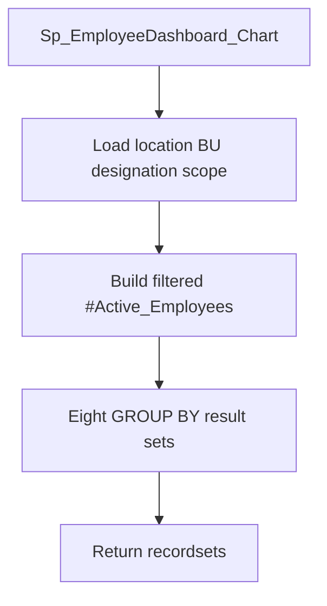

# Sp_EmployeeDashboard_Chart

## What it does

Returns the eight Employee Dashboard distribution chart series for one employer and login. After the same location / business-unit / designation scoping and workforce filters used by the card procedure, it emits separate result sets grouped by business unit, role, base location, domain, skill, employment type, company experience, and designation. The Core API maps those recordsets to `byBusinessUnit`, `byRole`, `byLocation`, `byDomain`, `bySkill`, `byEmployementType`, `byExperience`, and `byDesignation`.

## Parameters

| Name | Direction | What it is for |
|---|---|---|
| `@LoginID` | in | Logged-in employee used for location and BU scope |
| `@EmployerID` | in | Employer whose workforce is aggregated |
| `@BusinessUnitID` | in | Optional comma-separated business unit filter |
| `@BaseLocationID` | in | Optional base location ids |
| `@WorkLocationID` | in | Optional work location ids |
| `@Gender` | in | Optional gender filter values |
| `@AgeRange` | in | Optional age-range labels |
| `@DesignationID` | in | Optional designation ids |
| `@EmploymentTypeID` | in | Optional employment type ids |
| `@RoleID` | in | Optional employee role ids |
| `@SkillID` | in | Optional skill ids |
| `@DomainID` | in | Optional domain ids |
| `@ExperienceRange` | in | Optional company-experience labels |
| `@WorkForceStatus` | in | Active / InActive / OnNotice filter path |
| `@DOJ_FromDate` | in | Optional DOJ range start |
| `@DOJ_ToDate` | in | Optional DOJ range end |
| `@LWD_FromDate` | in | Optional last-working-date range start |
| `@LWD_ToDate` | in | Optional last-working-date range end |

## Call sequence

```mermaid
sequenceDiagram
  participant Caller
  participant Main as Sp_EmployeeDashboard_Chart
  participant Loc as SP_EmployeeDashboard_GetLocationByEmployeeId
  participant Bu as SP_EmployeeDashboard_GetBusinessUnitByOrg_EmployeeId
  participant Title as SP_CM_GetTitle
  Caller->>Main: execute
  Main->>Loc: load @WorkLocation
  Main->>Bu: load @BusinessUnit
  Main->>Title: load @Designation
  Main->>Main: eight GROUP BY result sets
```

## Callers

| Object | Kind | Page |
|---|---|---|
| `EmployeeRepository.getChartsData` | app | [Employee Dashboard](/docs/guides/employee-management/employee-dashboard) |

No other procedure in `STOREPROCEDURE/` executes it.

## Nested

| Object | Kind | When | Page |
|---|---|---|---|
| `SP_EmployeeDashboard_GetLocationByEmployeeId` | procedure | always at start | [SP_EmployeeDashboard_GetLocationByEmployeeId](/docs/database/hrms/SP_EmployeeDashboard_GetLocationByEmployeeId) |
| `SP_EmployeeDashboard_GetBusinessUnitByOrg_EmployeeId` | procedure | always at start | [SP_EmployeeDashboard_GetBusinessUnitByOrg_EmployeeId](/docs/database/hrms/SP_EmployeeDashboard_GetBusinessUnitByOrg_EmployeeId) |
| `SP_CM_GetTitle` | procedure | always at start | [SP_CM_GetTitle](/docs/database/hrms/SP_CM_GetTitle) |

## Steps

From `HRMS-DATABASE/HRMS/STOREPROCEDURE/Sp_EmployeeDashboard_Chart.sql`:

1. EXEC location, business-unit, and title helpers into table variables.
2. Build employment-type, domain, skill, resignation, experience, and age-range temps.
3. Populate `#Active_Employees` under the workforce-status branch with the optional filters.
4. Return eight SELECT aggregations (unit, role, location, domain, skill, employment type, experience, designation).

## Tables

| Table | Read or write |
|---|---|
| `dbo.TEmployee` | read |
| `dbo.TEmployeeInfo` | read |
| `dbo.TGender` | read |
| `dbo.TMEmploymentTypes` | read |
| `dbo.TEmploymentTypeClubWith` | read |
| `dbo.TEmployeeDomainDetails` | read |
| `dbo.TSkillDomainMaster` | read |
| `dbo.TEmployeeSkillDetails` | read |
| `dbo.TMSkills` | read |
| `dbo.TEmployeeRoleMaster` | read |
| `dbo.TResignationDetails` | read |
| `dbo.TResignation` | read |

## Unresolved calls

None.

## Flow


