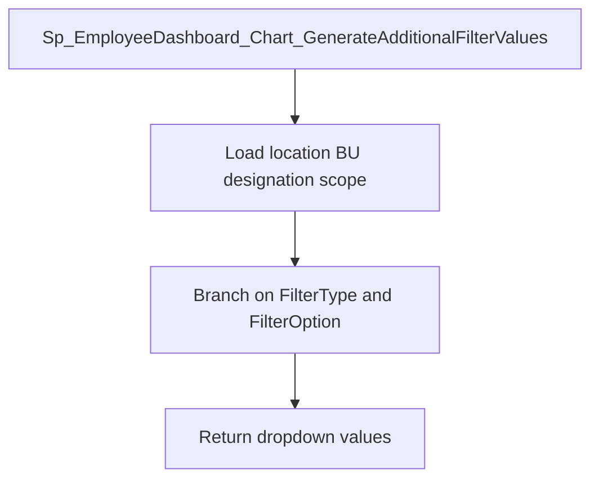

# Sp_EmployeeDashboard_Chart_GenerateAdditionalFilterValues

## What it does

Returns dropdown values for one Employee Dashboard filter field. After loading the caller's location and business-unit scope (and designations via `SP_CM_GetTitle`), it branches on `@FilterType` and `@FilterOption` to select genders, designations, employment types, roles, skills, domains, experience labels, business units, locations, or workforce-status labels.

## Parameters

| Name | Direction | What it is for |
|---|---|---|
| `@EmployeeID` | in | Logged-in employee used for location and BU scope |
| `@EmployerID` | in | Employer whose master lists are read |
| `@BusinessUnitIds` | in | Optional prior BU selection (passed through; used by some option paths) |
| `@LocationIds` | in | Optional prior location selection |
| `@FilterType` | in | Group such as Employee Attributes or Organization Dimentions |
| `@FilterOption` | in | Field within the group such as Gender or Business Unit |
| `@Type` | in | Defaults to `chart` |

## Call sequence

```mermaid
sequenceDiagram
  participant Caller
  participant Main as Sp_EmployeeDashboard_Chart_GenerateAdditionalFilterValues
  participant Loc as SP_EmployeeDashboard_GetLocationByEmployeeId
  participant Bu as SP_EmployeeDashboard_GetBusinessUnitByOrg_EmployeeId
  participant Title as SP_CM_GetTitle
  Caller->>Main: execute
  Main->>Loc: load @WorkLocation
  Main->>Bu: load @BusinessUnit
  Main->>Title: load @Designation
  Main->>Main: SELECT values for FilterType and FilterOption
```

## Callers

| Object | Kind | Page |
|---|---|---|
| `EmployeeRepository.GetAdditionalFilterValues` | app | [Employee Dashboard](/docs/guides/employee-management/employee-dashboard) |
| `managementDashboardDAL` | app | No page yet |
| `leaveAttendanceManagementDashboardDAL` | app | No page yet |

No other procedure in `STOREPROCEDURE/` executes it.

## Nested

| Object | Kind | When | Page |
|---|---|---|---|
| `SP_EmployeeDashboard_GetLocationByEmployeeId` | procedure | always at start | [SP_EmployeeDashboard_GetLocationByEmployeeId](/docs/database/hrms/SP_EmployeeDashboard_GetLocationByEmployeeId) |
| `SP_EmployeeDashboard_GetBusinessUnitByOrg_EmployeeId` | procedure | always at start | [SP_EmployeeDashboard_GetBusinessUnitByOrg_EmployeeId](/docs/database/hrms/SP_EmployeeDashboard_GetBusinessUnitByOrg_EmployeeId) |
| `SP_CM_GetTitle` | procedure | always at start | [SP_CM_GetTitle](/docs/database/hrms/SP_CM_GetTitle) |

## Steps

From `HRMS-DATABASE/HRMS/STOREPROCEDURE/Sp_EmployeeDashboard_Chart_GenerateAdditionalFilterValues.sql`:

1. EXEC location, business-unit, and title helpers into table variables; build employment-type and workforce-status temps.
2. Branch on `@FilterType` / `@FilterOption` (Gender from `TGender`, Designation from `@Designation`, Business Unit from `@BusinessUnit`, locations from `@WorkLocation`, and so on).
3. Return the matching `ID` / `Value` (or equivalent) result set for the filter dialog.

## Tables

| Table | Read or write |
|---|---|
| `dbo.TGender` | read |
| `dbo.TMEmploymentTypes` | read |
| `dbo.TEmploymentTypeClubWith` | read |
| `dbo.TEmployeeRoleMaster` | read |
| `dbo.TMSkills` | read |
| `dbo.TSkillDomainMaster` | read |

Scoped location and BU rows come from the nested procedures; designation rows from `SP_CM_GetTitle`.

## Unresolved calls

None.

## Flow


