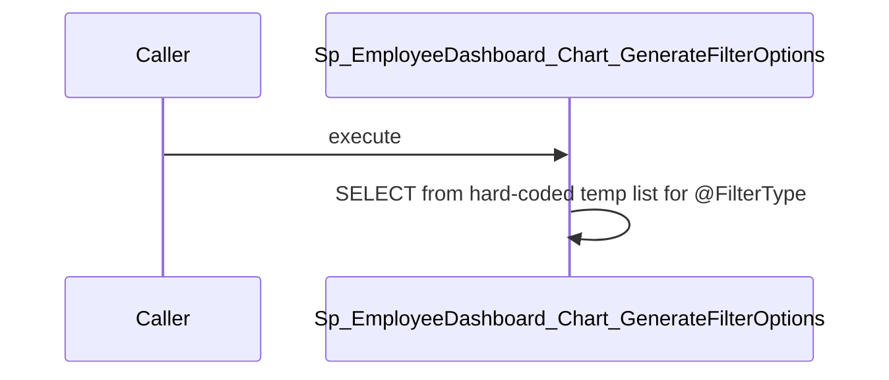
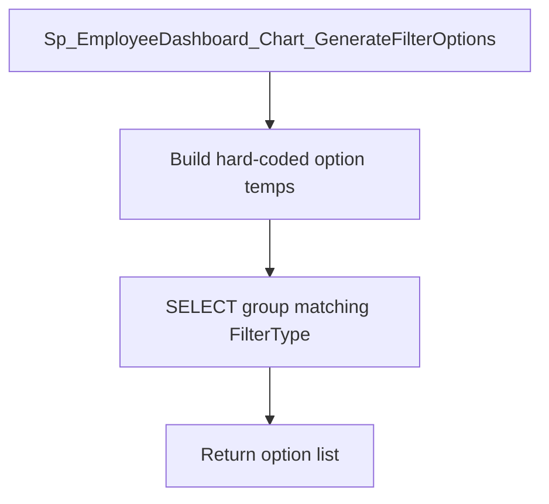

# Sp_EmployeeDashboard_Chart_GenerateFilterOptions

## What it does

Returns the static list of filter field names for one filter type on Employee Dashboard (and related management dashboards that reuse it). It does not read employee tables. Depending on `@FilterType`, it selects from hard-coded temp lists such as Employee Attributes (Gender, Designation, Employment Type, Role, Skill, Domain, Company Experience), Organization Dimensions (Business Unit, Base Location, Work Location), Workforce Status (Employment Status, Date Of Joining, Last Working Date), Leave & Attendance Dimensions, or Reporting View.

## Parameters

| Name | Direction | What it is for |
|---|---|---|
| `@FilterType` | in | Which option group to return |
| `@Type` | in | Defaults to `chart`; accepted by the signature but not used to change the lists |

## Call sequence

Calls no other procedures or functions.

## Callers

| Object | Kind | Page |
|---|---|---|
| `EmployeeRepository.GetAdditionalFilterOptions` | app | [Employee Dashboard](/docs/guides/employee-management/employee-dashboard) |
| `managementDashboardDAL` | app | No page yet |
| `leaveAttendanceManagementDashboardDAL` | app | No page yet |

No other procedure in `STOREPROCEDURE/` executes it.

## Nested

Calls no other procedures or functions.

## Steps

From `HRMS-DATABASE/HRMS/STOREPROCEDURE/Sp_EmployeeDashboard_Chart_GenerateFilterOptions.sql`:

1. Insert fixed option labels into `#EmpAttributes`, `#OrgDimentions`, `#Workforce`, `#LeaveAttendanceDimentions`, and `#ReportingView`.
2. If `@FilterType` equals one of those groups, SELECT `ID` and `Value` from the matching temp table.
3. Return that single result set.

## Tables

None. Option labels are hard-coded inserts into temp tables.

## Unresolved calls

None.

## Flow

