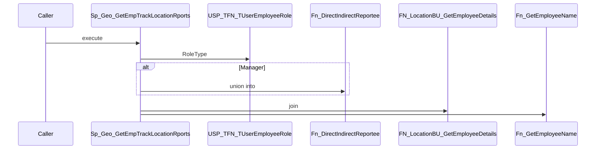
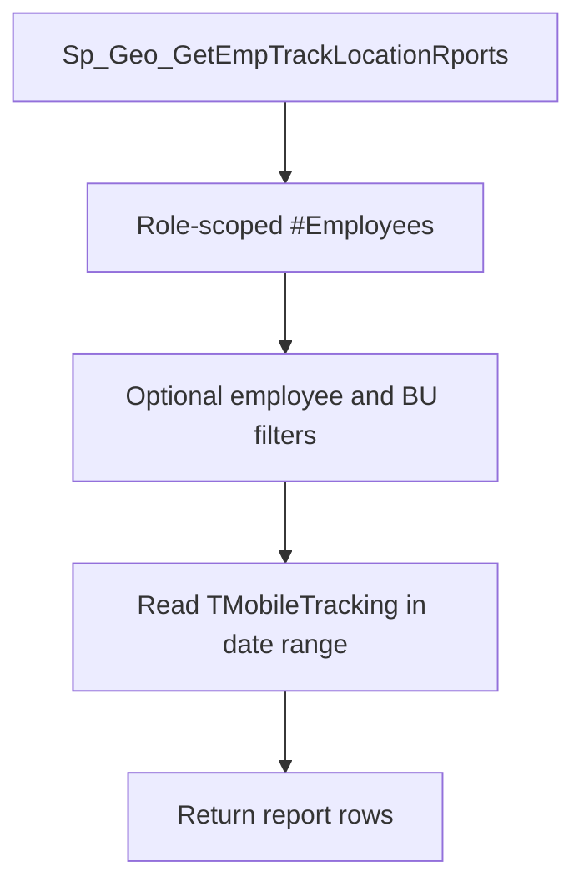

# Sp_Geo_GetEmpTrackLocationRports

## What it does

Returns mobile tracking point rows for an employer and date range for the Geo Tracking Reports tab. It builds a role-scoped `#Employees` set (Administrator/HR = all employer employees; Manager = same BU plus reportees; Employee = self), optionally narrows by employee and business-unit id lists, then reads `TMobileTracking` with a sargable date range and location-BU join. Employee names are resolved once per distinct employee via `Fn_GetEmployeeName`.

## Parameters

| Name | Direction | What it is for |
|---|---|---|
| `@EmployerId` | in | Employer of the tracking points |
| `@TrackingFromDate` | in | Range start (date string) |
| `@TrackingToDate` | in | Range end (date string, exclusive end-of-day) |
| `@BusinessUnitIds` | in | Optional comma-separated BUs |
| `@EmployeeIds` | in | Optional comma-separated employees |
| `@LoggedinUserId` | in | Login user for role scope |

## Call sequence

## Callers

No other procedure or function calls this object. `GeoTrackingDAL.GetEmpTrackLocationRports` executes it.

## Nested

| Object | Kind | When | Page |
|---|---|---|---|
| `USP_TFN_TUserEmployeeRole` | function | always | [USP_TFN_TUserEmployeeRole](/docs/database/hrms/USP_TFN_TUserEmployeeRole) |
| `Fn_DirectIndirectReportee` | function | Manager branch | [Fn_DirectIndirectReportee](/docs/database/hrms/Fn_DirectIndirectReportee) |
| `FN_LocationBU_GetEmployeeDetails` | function | join | [FN_LocationBU_GetEmployeeDetails](/docs/database/hrms/FN_LocationBU_GetEmployeeDetails) |
| `Fn_GetEmployeeName` | function | `#ResolvedNames` | [Fn_GetEmployeeName](/docs/database/hrms/Fn_GetEmployeeName) |

## Steps

1. In `HRMS-DATABASE/HRMS/STOREPROCEDURE/Sp_Geo_GetEmpTrackLocationRports.sql`, resolve `@RoleType` and fill `#Employees` by role.
2. Optionally materialize `#RequestedEmployees` / `#RequestedBusinessUnits` from `STRING_SPLIT` and narrow `#Employees`.
3. Convert from/to dates to a half-open datetime range.
4. Build `#ResolvedNames` with one `Fn_GetEmployeeName` per employee in `#Employees`.
5. Select from `TMobileTracking` joined to employer, employee, BU, location-BU scope, and `#ResolvedNames`. Order by `TrackingDate` descending.

## Tables

| Table | Read or write |
|---|---|
| `dbo.TMobileTracking` | read |
| `dbo.TEmployee` | read |
| `dbo.TEmployeeInfo` | read |
| `dbo.TEmployerDetails` | read |
| `dbo.TOrgHierarchyDetails` | read |

## Flow

