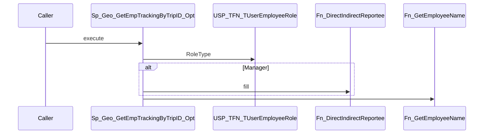
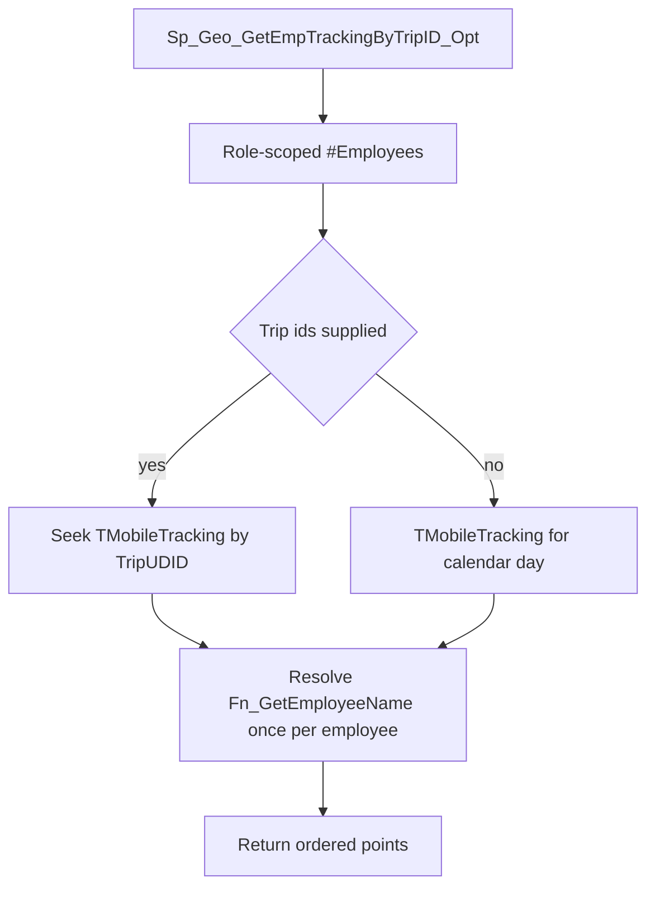

# Sp_Geo_GetEmpTrackingByTripID_Opt

## What it does

Returns ordered `TMobileTracking` points for the Tracking Maps tab. The inventoried script path is `Sp_Geo_GetEmpTrackingByTripID.sql`, but the `CREATE OR ALTER` object name inside that file is `Sp_Geo_GetEmpTrackingByTripID_Opt`. It may also create index `IX_TMobileTracking_Employer_TripUDID` when missing. Role scope matches the reports procedure. When trip ids are supplied, points are loaded by `(EmployerId, TripUDID)` without a date predicate so overnight trips stay intact; otherwise points are loaded for the requested calendar day. Employee names are resolved once per distinct employee.

## Parameters

| Name | Direction | What it is for |
|---|---|---|
| `@EmployerId` | in | Employer of the points |
| `@TrackingFromDate` | in | Local date string used when trip ids are absent |
| `@EmployeeIds` | in | Optional comma-separated employees |
| `@trackingIds` | in | Optional comma-separated TripUDIDs |
| `@LoggedinUserId` | in | Login user for role scope |

## Call sequence

## Callers

No other procedure or function in this database's scripts executes this `_Opt` name. `GeoTrackingDAL.GetEmpTrackingByTripID` still executes `Sp_Geo_GetEmpTrackingByTripID` (exact name has no `CREATE` under `STOREPROCEDURE/` in this checkout).

## Nested

| Object | Kind | When | Page |
|---|---|---|---|
| `USP_TFN_TUserEmployeeRole` | function | always | [USP_TFN_TUserEmployeeRole](/docs/database/hrms/USP_TFN_TUserEmployeeRole) |
| `Fn_DirectIndirectReportee` | function | Manager branch | [Fn_DirectIndirectReportee](/docs/database/hrms/Fn_DirectIndirectReportee) |
| `Fn_GetEmployeeName` | function | `#ResolvedNames` | [Fn_GetEmployeeName](/docs/database/hrms/Fn_GetEmployeeName) |

## Steps

1. In `HRMS-DATABASE/HRMS/STOREPROCEDURE/Sp_Geo_GetEmpTrackingByTripID.sql`, optionally create `IX_TMobileTracking_Employer_TripUDID` if it does not exist.
2. Create or alter `Sp_Geo_GetEmpTrackingByTripID_Opt`. Resolve `@RoleType` and fill `#Employees` (Administrator/HR, Manager with reportees, or Employee self). Optional `#TrackingIds` / `#RequestedEmployees` from `STRING_SPLIT`.
3. If trip ids are present: insert into `#Points` from `TMobileTracking` forced to that index seek, scoped by `#Employees`. No date filter on this branch.
4. Else: insert points for `#Employees` where `TrackingDate` is in the one-day window from `@TrackingFromDate`.
5. Resolve names into `#ResolvedNames`, update `#Points`, return points ordered by `TrackingDate`, `MobileTrackingId`.

## Tables

| Table | Read or write |
|---|---|
| `dbo.TMobileTracking` | read |
| `dbo.TEmployee` | read |
| `dbo.TEmployeeInfo` | read |
| `dbo.TEmployerDetails` | read |
| `dbo.TOrgHierarchyDetails` | read |

## Flow

