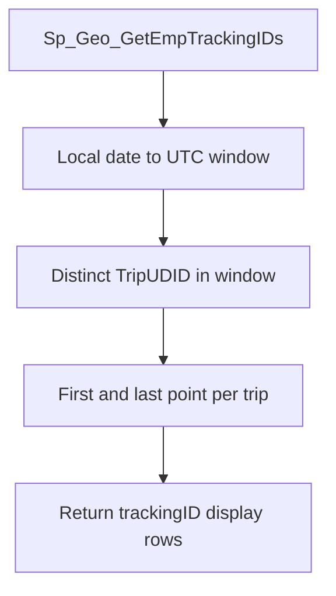

# Sp_Geo_GetEmpTrackingIDs

## What it does

Returns distinct trip UDIDs for one employee on a client-local calendar date. Tracking timestamps are stored in UTC; `@TimeZoneOffsetMinutes` converts the local date into a UTC window so overnight trips are not shifted a day. For each trip it returns start/end times and coordinates plus a display `trackingID` string.

## Parameters

| Name | Direction | What it is for |
|---|---|---|
| `@EmployerId` | in | Employer of the points |
| `@TrackingDate` | in | Local calendar date string |
| `@EmployeeId` | in | Employee whose trips are listed |
| `@TimeZoneOffsetMinutes` | in | Minutes east of UTC (default 0) |

## Call sequence

Calls no other procedures or functions.

## Callers

No other procedure or function calls this object. `GeoTrackingDAL.GetEmpTrackingIds` executes it for the Tracking Maps tab.

## Nested

Calls no other procedures or functions.

## Steps

1. In `HRMS-DATABASE/HRMS/STOREPROCEDURE/Sp_Geo_GetEmpTrackingIDs.sql`, convert `@TrackingDate` to a local date and compute `@UtcStart` / `@UtcEnd` with `@TimeZoneOffsetMinutes`.
2. CTE `CandidateTrips` selects distinct non-empty `TripUDID` values from `TMobileTracking` in that UTC window for the employer and employee.
3. For each trip, cross-apply the earliest and latest point (by `TrackingDate`, `MobileTrackingId`).
4. Keep rows whose start time still falls in the UTC window. Order by start date descending. `OPTION (RECOMPILE)`.

## Tables

| Table | Read or write |
|---|---|
| `dbo.TMobileTracking` | read |

## Flow

