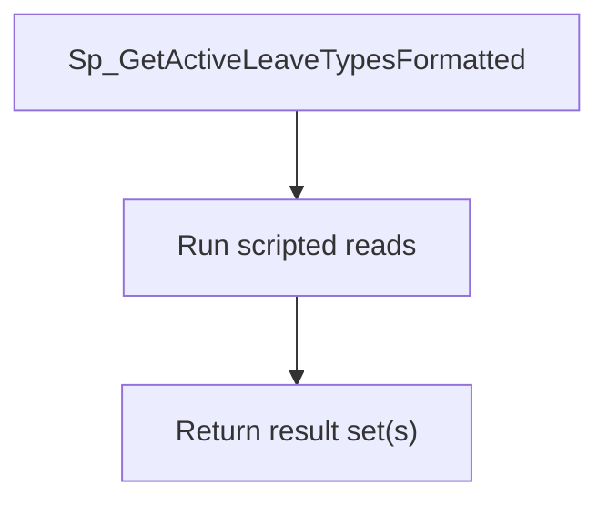

# Sp_GetActiveLeaveTypesFormatted

## What it does

Active leave types for the employer, formatted for management-dashboard leave-type filters.

## Parameters

| Name | Direction | What it is for |
|---|---|---|
| `@EmployerID` | in | `INT` |

## Call sequence

Calls no other procedures or functions.

## Callers

No other procedure or function calls this object. Node `leaveAttendanceManagementDashboardDAL.getLeaveTypes` executes it.

## Nested

Calls no other procedures or functions.

## Steps

1. In `HRMS-DATABASE/HRMS/STOREPROCEDURE/Sp_GetActiveLeaveTypesFormatted.sql`, accept the declared parameters and set `NOCOUNT` / read-uncommitted as scripted.
2. Run the SELECT branches shown in the script and return the result set(s).

## Tables

| Table | Read or write |
|---|---|
| `dbo.TLeaveTypeMaster` | read |

## Flow

