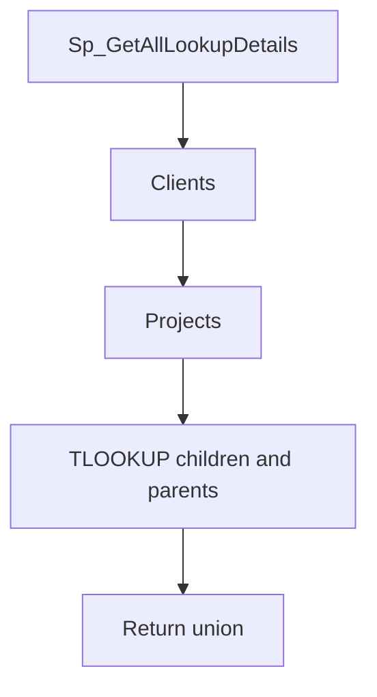

# Sp_GetAllLookupDetails

## What it does

Returns a unified lookup catalogue for an employer: clients (`LookupParentId` 100), projects (`2000`) with optional `TProjectConfDetails`, child `TLOOKUP` rows (excluding client/project parents), and root `TLOOKUP` parents (`Lookup_Parent_ID = 0`). Donor Information Setup filters this set for donor type/source and budget dropdowns.

## Parameters

| Name | Direction | What it is for |
|---|---|---|
| `@pEmployerId` | in | Employer scope |

## Call sequence

Calls no other procedures or functions.

## Callers

Application: Donor Information Setup `GetAllLookupDetails` and many other Recruitment screens. No other procedure or function calls this object.

## Nested

Calls no other procedures or functions.

## Steps

1. Union clients from `TClient` (with BU names via mapping).
2. Union projects from `TProject` with config and client mapping.
3. Union child `TLOOKUP` rows joined to parent text (and optional reallocation config).
4. Union root `TLOOKUP` parents for the employer.

## Tables

| Table | Read or write |
|---|---|
| `TClient` | read |
| `TClientBusinessUnitMapping` | read |
| `TOrgHierarchyDetails` | read |
| `TProject` | read |
| `TClientProjectMapping` | read |
| `TProjectConfDetails` | read |
| `TLOOKUP` | read |
| `TReallocationConfDetails` | read |

## Unresolved calls

None.

## Flow

