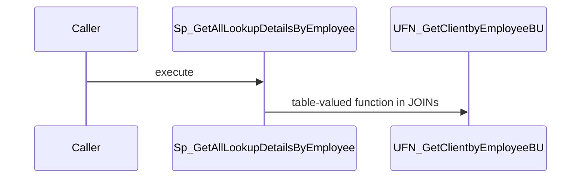
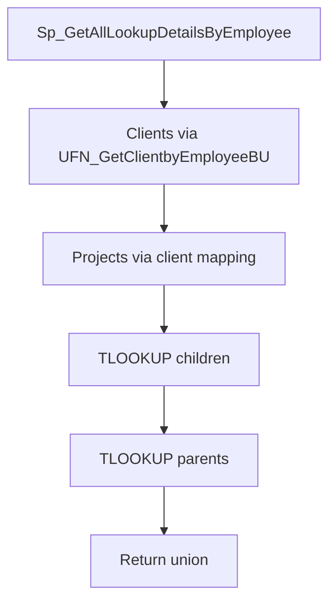

# Sp_GetAllLookupDetailsByEmployee

## What it does

Returns the unified RA reference list for one employer, scoped to clients visible to the employee’s business units. Unions active `TClient` rows, `TProject` rows (with optional `TProjectConfDetails`), child `TLOOKUP` rows (excluding parents 100 and 2000, with optional `TReallocationConfDetails`), and root parent `TLOOKUP` rows (`Lookup_Parent_ID = 0`).

## Parameters

| Name | Direction | What it is for |
|---|---|---|
| `@pEmployerId` | in | Employer whose reference data is listed |
| `@pEmployeeId` | in | Employee used to filter clients by BU |

## Call sequence

## Callers

No other procedure or function calls this object in the HRMS procedure/function trees searched for live `EXEC`/`dbo.` invocations. Application caller: RA WebAPI `GetAllLookupDetailsByEmployee`.

## Nested

| Object | Kind | When | Page |
|---|---|---|---|
| `UFN_GetClientbyEmployeeBU` | function | client and project union branches | [UFN_GetClientbyEmployeeBU](/docs/database/hrms/UFN_GetClientbyEmployeeBU) |

## Steps

1. Script is `HRMS-DATABASE/HRMS/STOREPROCEDURE/Sp_GetAllLookupDetailsByEmployee.sql`.
2. Select clients from `TClient` joined to `UFN_GetClientbyEmployeeBU(@pEmployeeId)`, not deleted, for `@pEmployerId`, with BU names from `TClientBusinessUnitMapping` / `TOrgHierarchyDetails`.
3. Union projects from `TProject` joined through `TClientProjectMapping` to the same function, left join `TProjectConfDetails`.
4. Union non-root `TLOOKUP` children (parent not 100/2000) with parent text and optional `TReallocationConfDetails`.
5. Union root `TLOOKUP` parents (`Lookup_Parent_ID = 0`).

## Tables

| Table | Read or write |
|---|---|
| `dbo.TClient` | read |
| `dbo.TClientBusinessUnitMapping` | read |
| `dbo.TOrgHierarchyDetails` | read |
| `dbo.TProject` | read |
| `dbo.TClientProjectMapping` | read |
| `dbo.TProjectConfDetails` | read |
| `dbo.TLOOKUP` | read |
| `dbo.TReallocationConfDetails` | read |

## Flow

