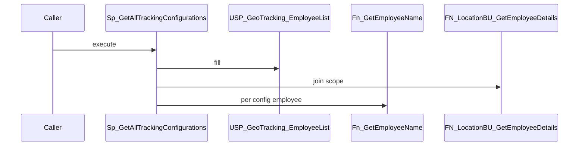
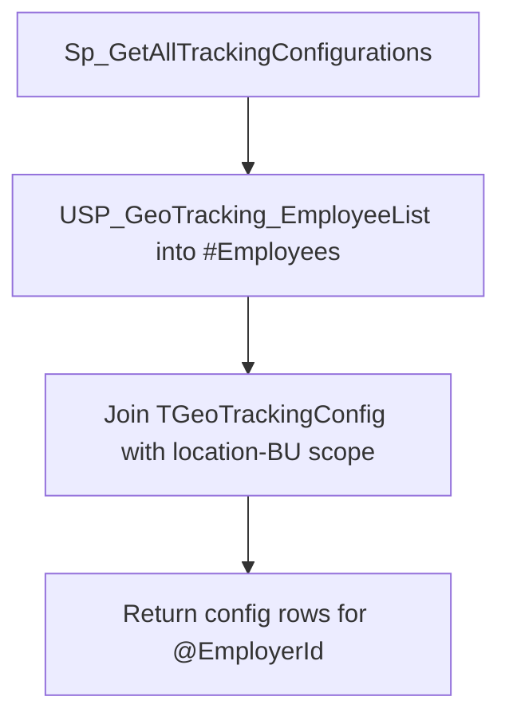

# Sp_GetAllTrackingConfigurations

## What it does

Returns geo tracking configuration rows for one employer, limited to employees the login user may see. It materializes that employee set through `USP_GeoTracking_EmployeeList`, then joins `TGeoTrackingConfig` to employer, employee info, and `FN_LocationBU_GetEmployeeDetails`. Display columns include Auto/Manual, As Per Shift/Custom, attendance-based flag, and employee active status.

## Parameters

| Name | Direction | What it is for |
|---|---|---|
| `@EmployerId` | in | Employer whose configs are listed |
| `@LoginEmployeeId` | in | Signed-in employee used for role and location-BU scope |

## Call sequence

## Callers

No other procedure or function calls this object. `GeoTrackingDAL.GetAllTrackingConfigurations` executes it for Admin Configuration GeoTracking.

## Nested

| Object | Kind | When | Page |
|---|---|---|---|
| `USP_GeoTracking_EmployeeList` | procedure | always, into `#Employees` | [USP_GeoTracking_EmployeeList](/docs/database/hrms/USP_GeoTracking_EmployeeList) |
| `Fn_GetEmployeeName` | function | select list | [Fn_GetEmployeeName](/docs/database/hrms/Fn_GetEmployeeName) |
| `FN_LocationBU_GetEmployeeDetails` | function | join filter | [FN_LocationBU_GetEmployeeDetails](/docs/database/hrms/FN_LocationBU_GetEmployeeDetails) |

## Steps

1. In `HRMS-DATABASE/HRMS/STOREPROCEDURE/Sp_GetAllTrackingConfigurations.sql`, set `NOCOUNT` and `READ UNCOMMITTED`.
2. Create `#Employees` and fill it with `EXEC USP_GeoTracking_EmployeeList @LoginEmployeeId`.
3. Select from `TGeoTrackingConfig` joined to `TEmployerDetails`, `#Employees`, `TEmployeeInfo`, `TEmployee`, and `FN_LocationBU_GetEmployeeDetails(@LoginEmployeeId, @EmployerId)`.
4. Filter `TG.EmployerId = @EmployerId`. Order by `UpdatedOn` or `CreatedOn` descending.
5. Map `TrackingisAuto` and `TrackingOnShift` bits to display strings; return `IsAttendanceBasedTrackingEnabled` and `EMPStatus` from `TEmployee.IsActive`.

## Tables

| Table | Read or write |
|---|---|
| `dbo.TGeoTrackingConfig` | read |
| `dbo.TEmployerDetails` | read |
| `dbo.TEmployeeInfo` | read |
| `dbo.TEmployee` | read |

## Flow

