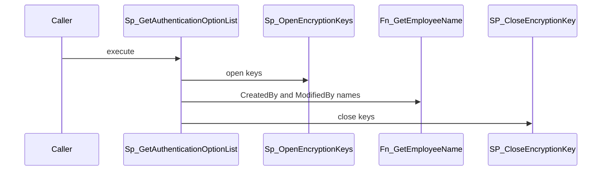
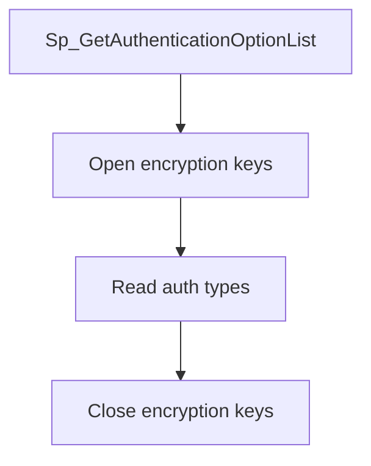

# Sp_GetAuthenticationOptionList

## What it does

Returns authentication option rows for one employer, with creator and modifier display names. Opens and closes encryption keys around the select.

## Parameters

| Name | Direction | What it is for |
|---|---|---|
| `@employerid` | in | Employer whose auth types are listed |

## Call sequence

## Callers

No other procedure or function calls this object.

## Nested

| Object | Kind | When | Page |
|---|---|---|---|
| `Sp_OpenEncryptionKeys` | procedure | before the select | [Sp_OpenEncryptionKeys](/docs/database/hrms/Sp_OpenEncryptionKeys) |
| `Fn_GetEmployeeName` | function | for CreatedBy and ModifiedBy | [Fn_GetEmployeeName](/docs/database/hrms/Fn_GetEmployeeName) |
| `SP_CloseEncryptionKey` | procedure | after the select | [SP_CloseEncryptionKey](/docs/database/hrms/SP_CloseEncryptionKey) |

## Steps

1. Execute `Sp_OpenEncryptionKeys`.
2. Select auth type rows from `POBCandidateAuthenticationType` for `@EmployerID`, resolving names with `Fn_GetEmployeeName`.
3. Execute `SP_CloseEncryptionKey`.

## Tables

| Table | Read or write |
|---|---|
| `POBCandidateAuthenticationType` | read |

## Flow

