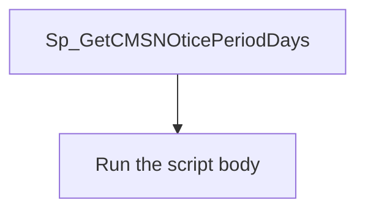

# Sp_GetCMSNOticePeriodDays

## What it does

Lists probation-extension day counts for an employer. `@ActiveType` chooses active, inactive, or both.

## Parameters

| Name | Direction | What it is for |
|---|---|---|
| `@EmployerId` | in | Employer Id |
| `@ActiveType` | in | Active Type |

## Call sequence

Calls no other procedures or functions.

## Callers

No other procedure or function calls this object.

## Nested

Calls no other procedures or functions.

## Steps

Script: `HRMS-DATABASE/HRMS/STOREPROCEDURE/Sp_GetCMSNOticePeriodDays.sql`.

1. If @ActiveType='A'
2. Select Transid,
3. else If @ActiveType='B'
4. Select Transid,

## Tables

| Table | Read or write |
|---|---|
| `TCMSNOticePeriodDays` | read |

## Flow

