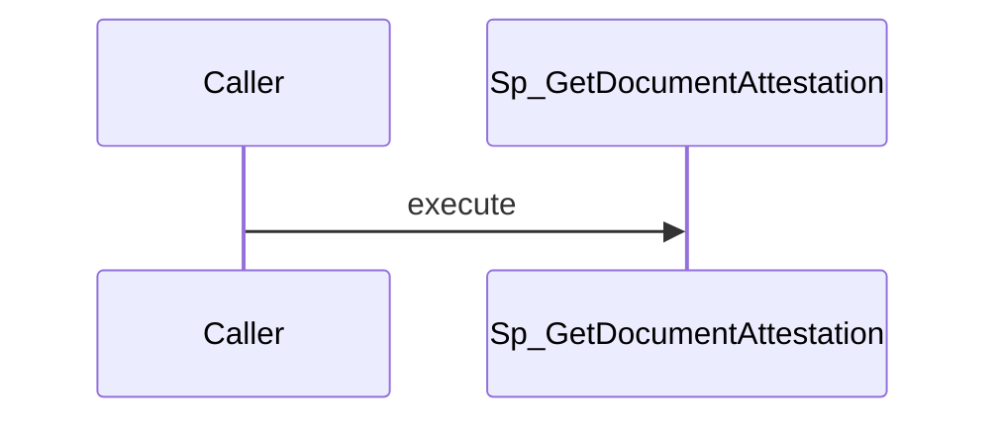
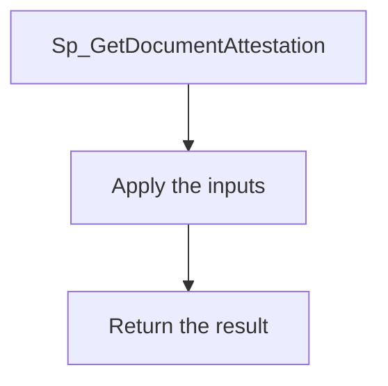

# Sp_GetDocumentAttestation

## What it does

Returns policy documents the employee still has to sign, or has already attested. The Home policy reminder reads this list.

## Parameters

| Name | Direction | What it is for |
|---|---|---|
| `@EmployeeId` | in | Employee the Home screen is loading or acting for (`int`) |
| `@FilterType` | in | Input used by this procedure (`varchar`) |

## Call sequence

## Callers

No other procedure or function under STOREPROCEDURE or FUNCTIONS executes this object.

## Nested

This object does not execute another procedure or user-defined function.

## Steps

In `HRMS-DATABASE/HRMS/STOREPROCEDURE/Sp_GetDocumentAttestation.sql`:

1. Returns policy documents the employee still has to sign, or has already attested.
2. The Home policy reminder reads this list.

## Tables

| Table | Read or write |
|---|---|
| `TPolicyDocument` | read |
| `TDocumentAttestation` | read |
| `TEmployee` | read |
| `TEmployeeInfo` | read |

## Flow

