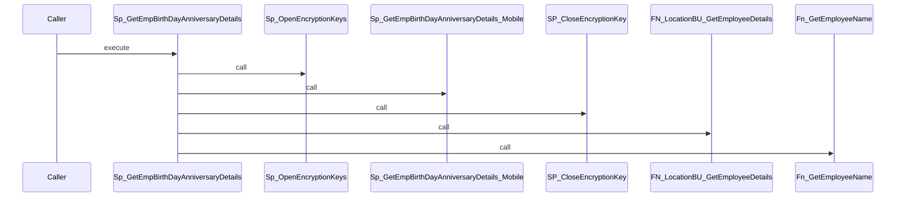
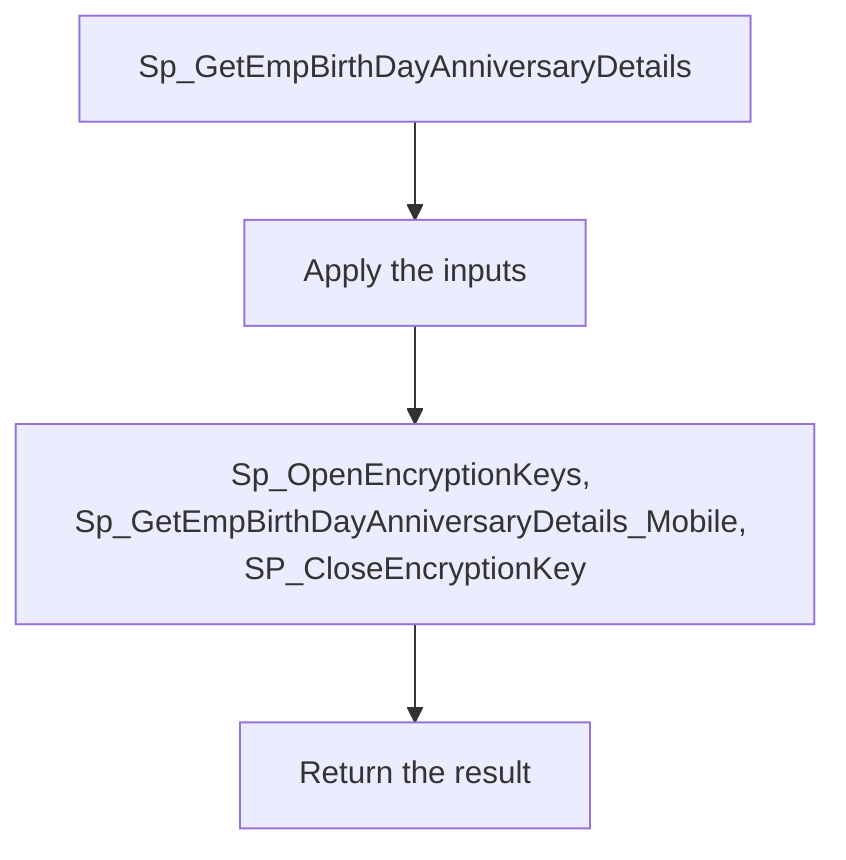

# Sp_GetEmpBirthDayAnniversaryDetails

## What it does

Returns today's birthday and work-anniversary colleagues when Celebrations Hub is off. The header uses this list for the wish strip.

## Parameters

| Name | Direction | What it is for |
|---|---|---|
| `@EmployerId` | in | Employer that owns the data (`INT`) |
| `@LoginEmployeeId` | in | Input used by this procedure (`INT`) |

## Call sequence

## Callers

No other procedure or function under STOREPROCEDURE or FUNCTIONS executes this object.

## Nested

| Object | Kind | When | Page |
|---|---|---|---|
| `Sp_OpenEncryptionKeys` | procedure | Called while this object runs | [Sp_OpenEncryptionKeys](/docs/database/hrms/Sp_OpenEncryptionKeys) |
| `Sp_GetEmpBirthDayAnniversaryDetails_Mobile` | procedure | Called while this object runs | [Sp_GetEmpBirthDayAnniversaryDetails_Mobile](/docs/database/hrms/Sp_GetEmpBirthDayAnniversaryDetails_Mobile) |
| `SP_CloseEncryptionKey` | procedure | Called while this object runs | [SP_CloseEncryptionKey](/docs/database/hrms/SP_CloseEncryptionKey) |
| `FN_LocationBU_GetEmployeeDetails` | function | Called while this object runs | [FN_LocationBU_GetEmployeeDetails](/docs/database/hrms/FN_LocationBU_GetEmployeeDetails) |
| `Fn_GetEmployeeName` | function | Called while this object runs | [Fn_GetEmployeeName](/docs/database/hrms/Fn_GetEmployeeName) |

## Steps

In `HRMS-DATABASE/HRMS/STOREPROCEDURE/Sp_GetEmpBirthDayAnniversaryDetails.sql`:

1. Returns today's birthday and work-anniversary colleagues when Celebrations Hub is off.
2. The header uses this list for the wish strip.

## Tables

| Table | Read or write |
|---|---|
| `TEmployerDetails` | read |
| `TEmployee` | read |
| `TEmployeeInfo` | read |
| `tUserEmployee` | read |
| `tUsers` | read |
| `TOrgHierarchyDetails` | read |
| `TLocation` | read |

## Flow

