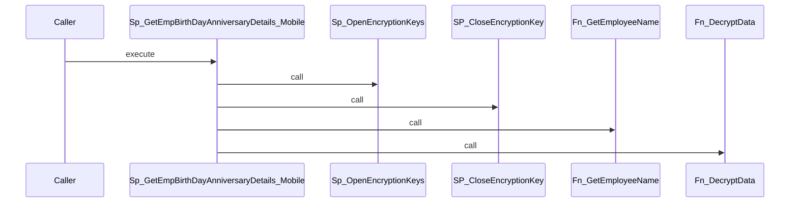
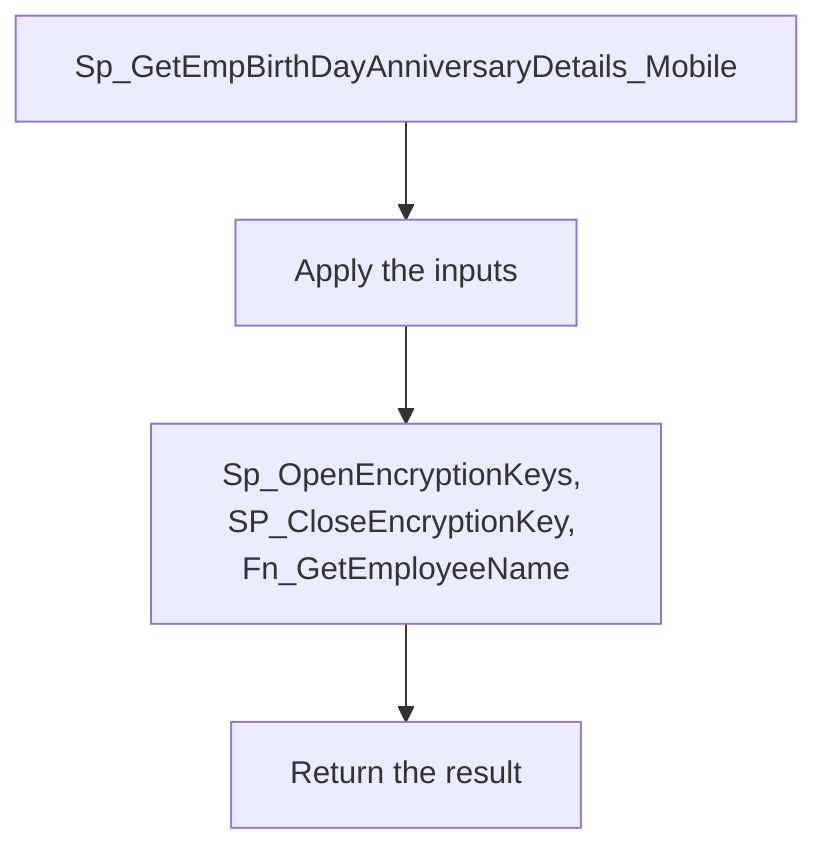

# Sp_GetEmpBirthDayAnniversaryDetails_Mobile

## What it does

Called from the Home dashboard path. It reads TemployerDetails, TOrgHierarchyDetails, TLocation, TEMPLOYEE, TEmployeeInfo and returns the result to its caller.

## Parameters

| Name | Direction | What it is for |
|---|---|---|
| `@EmployerId` | in | Employer that owns the data (`int`) |

## Call sequence

## Callers

| Object | Kind | Page |
|---|---|---|
| `Sp_GetEmpBirthDayAnniversaryDetails` | procedure | [Sp_GetEmpBirthDayAnniversaryDetails](/docs/database/hrms/Sp_GetEmpBirthDayAnniversaryDetails) |
| `Sp_GetEmpBirthDayAnniversaryDetails_DP` | procedure | No page yet |

## Nested

| Object | Kind | When | Page |
|---|---|---|---|
| `Sp_OpenEncryptionKeys` | procedure | Called while this object runs | [Sp_OpenEncryptionKeys](/docs/database/hrms/Sp_OpenEncryptionKeys) |
| `SP_CloseEncryptionKey` | procedure | Called while this object runs | [SP_CloseEncryptionKey](/docs/database/hrms/SP_CloseEncryptionKey) |
| `Fn_GetEmployeeName` | function | Called while this object runs | [Fn_GetEmployeeName](/docs/database/hrms/Fn_GetEmployeeName) |
| `Fn_DecryptData` | function | Called while this object runs | [Fn_DecryptData](/docs/database/hrms/Fn_DecryptData) |

## Steps

In `HRMS-DATABASE/HRMS/STOREPROCEDURE/Sp_GetEmpBirthDayAnniversaryDetails_Mobile.sql`:

1. Execute `Sp_OpenEncryptionKeys`, `SP_CloseEncryptionKey`.
2. Read through `Fn_GetEmployeeName`, `Fn_DecryptData`.
3. Read `TemployerDetails`, `TOrgHierarchyDetails`, `TLocation`, `TEMPLOYEE`, `TEmployeeInfo`, `tUserEmployee`, `tUsers`.
4. Return the result set to the caller.

## Tables

| Table | Read or write |
|---|---|
| `TemployerDetails` | read |
| `TOrgHierarchyDetails` | read |
| `TLocation` | read |
| `TEMPLOYEE` | read |
| `TEmployeeInfo` | read |
| `tUserEmployee` | read |
| `tUsers` | read |

## Flow

