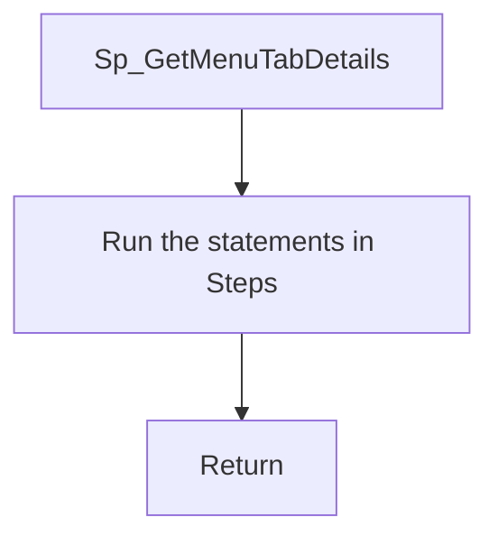

# Sp_GetMenuTabDetails

## What it does

Returns Tabid, MenuId, and TabName for the tab catalog. A super-admin user type S receives every active tab. Everyone else receives active tabs whose module is licensed to the employer's root.

## Parameters

| Name | Direction | What it is for |
|---|---|---|
| `@EmployerId` | in | Employer. Null is allowed. Used to find the root employer |
| `@UserType` | in | S returns the full active catalog |

## Call sequence

Calls no other procedures or functions.

## Callers

No other procedure or function calls this object.

## Nested

Calls no other procedures or functions.

## Steps

1. When @UserType is S, select every active TTabDetails row.
2. Otherwise read RootEmployerId and return distinct active tabs joined to TTabModuleMapping where the module is active on TEmployerModule for that root.

## Tables

| Table | Read or write |
|---|---|
| `TTabDetails` | read |
| `TEmployerDetails` | read |
| `TTabModuleMapping` | read |
| `TEmployerModule` | read |

## Flow

