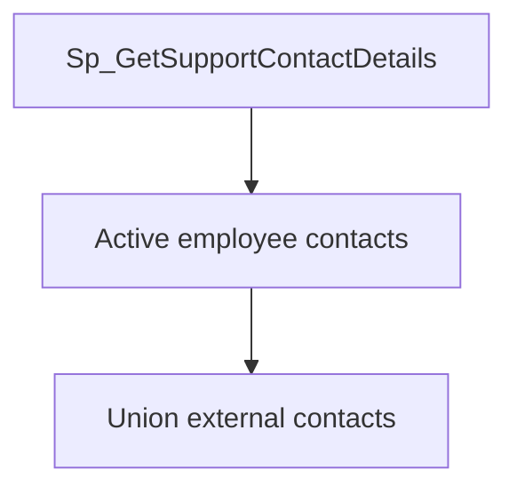

# Sp_GetSupportContactDetails

## What it does

Returns active support contacts for an employer. Employee contacts must belong to an active employee. External contacts, stored with employee id 0, are unioned without that employee check. The page calls this procedure through the name Sp_GetSupportcontactdetails.

## Parameters

| Name | Direction | What it is for |
|---|---|---|
| `@Employerid` | in | Employer |

## Call sequence

Calls no other procedures or functions.

## Callers

No other procedure or function calls this object.

## Nested

Calls no other procedures or functions.

## Steps

1. Select active contacts joined to the employer and an active employee (`Sp_GetSupportContactDetails.sql`).
2. Union active external contacts where `EmployeeId` is 0.

## Tables

| Table | Read or write |
|---|---|
| `dbo.TEmpSupportContact` | read |
| `dbo.tEmployerDetails` | read |
| `dbo.tEmployee` | read |

## Flow

