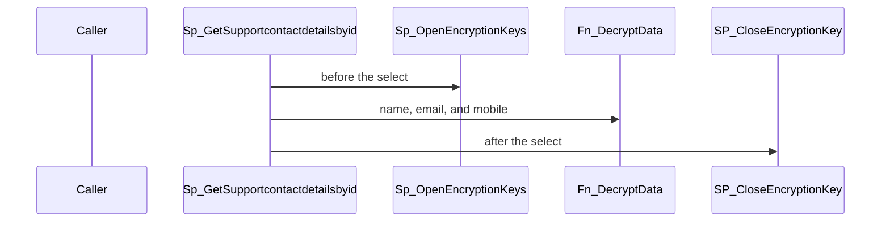
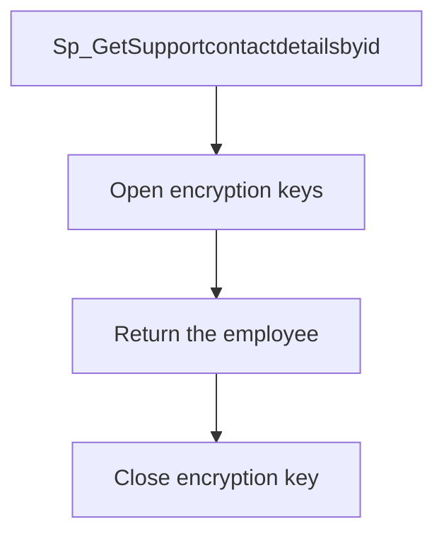

# Sp_GetSupportcontactdetailsbyid

## What it does

Returns one employee's decrypted name, email, and mobile number for the support-contact form. When the employer uses cross reporting, the lookup uses the root employer.

## Parameters

| Name | Direction | What it is for |
|---|---|---|
| `@Employerid` | in | Employer |
| `@EmploymentNumber` | in | Employment number |

## Call sequence

## Callers

No other procedure or function calls this object.

## Nested

| Object | Kind | When | Page |
|---|---|---|---|
| `Sp_OpenEncryptionKeys` | procedure | before the select | [Sp_OpenEncryptionKeys](/docs/database/hrms/Sp_OpenEncryptionKeys) |
| `Fn_DecryptData` | function | name, email, and mobile | [Fn_DecryptData](/docs/database/hrms/Fn_DecryptData) |
| `SP_CloseEncryptionKey` | procedure | after the select | [SP_CloseEncryptionKey](/docs/database/hrms/SP_CloseEncryptionKey) |

## Steps

1. Open encryption keys (`Sp_GetSupportcontactdetailsbyid.sql`).
2. When the employer has cross reporting, read `RootEmployerId`.
3. Select the employee by employment number and employer, decrypting first name, last name, email, and mobile.
4. Close the encryption key.

## Tables

| Table | Read or write |
|---|---|
| `dbo.tEmployerDetails` | read |
| `dbo.TEmployee` | read |
| `dbo.TEmployeeInfo` | read |

## Flow

