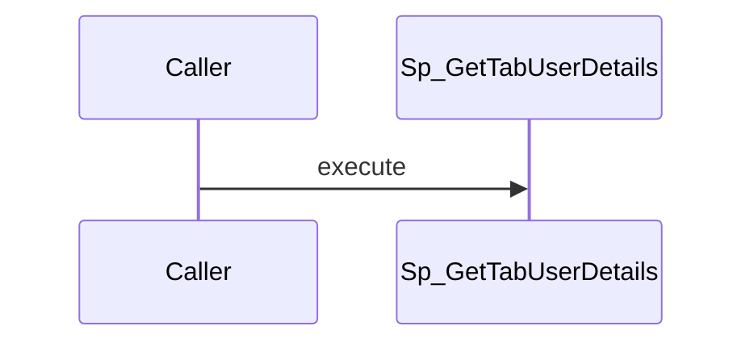
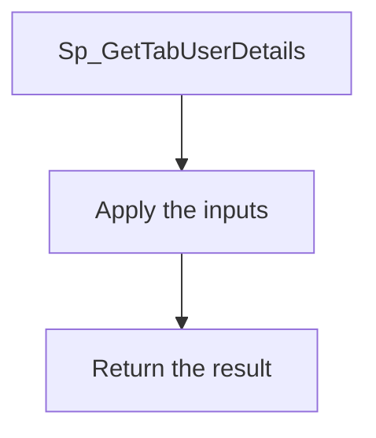

# Sp_GetTabUserDetails

## What it does

Returns every tab granted directly to the user. The attendance card merges these with the role tabs for menu 1173.

## Parameters

| Name | Direction | What it is for |
|---|---|---|
| `@Employerid` | in | Employer that owns the data (`Int`) |
| `@UserId` | in | User whose direct tab grants are loaded (`Int`) |

## Call sequence

## Callers

No other procedure or function under STOREPROCEDURE or FUNCTIONS executes this object.

## Nested

This object does not execute another procedure or user-defined function.

## Steps

In `HRMS-DATABASE/HRMS/STOREPROCEDURE/Sp_GetTabUserDetails.sql`:

1. Returns every tab granted directly to the user.
2. The attendance card merges these with the role tabs for menu 1173.

## Tables

| Table | Read or write |
|---|---|
| `TUserTabDetails` | read |

## Flow

