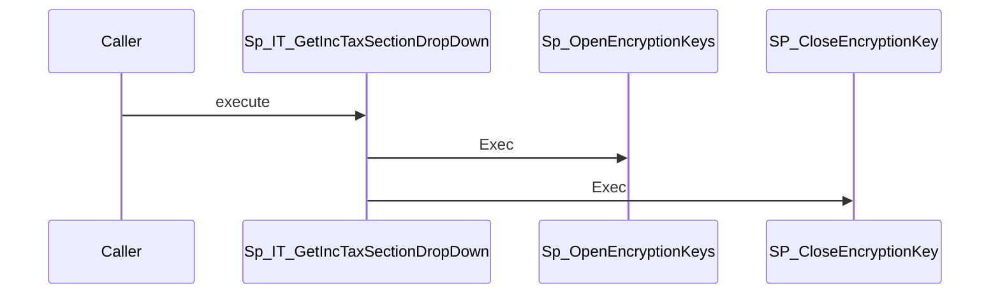
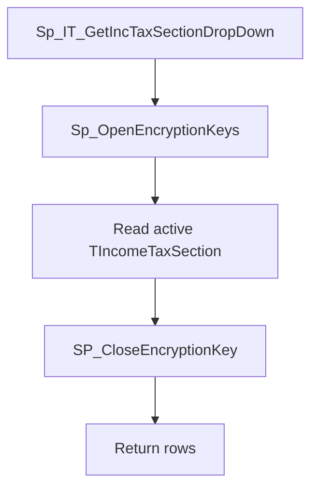

# Sp_IT_GetIncTaxSectionDropDown

## What it does

Returns active income-tax section id and name pairs for an employer for dropdown binding. Opens and closes encryption keys even though this select does not call `Fn_GetEmployeeName`. Used by PayRoll Setup Masters Manage Category Types and Manage Categories section dropdowns.

## Parameters

| Name | Direction | What it is for |
|---|---|---|
| `@EmployerId` | in | Employer scope |

## Call sequence

## Callers

| Object | Kind | Page |
|---|---|---|
| `IncomeTaxDeclarationDAL.GetIncomeTaxActiveSections` | app | [Setup Masters](/docs/guides/payroll/setup-masters) |

No other procedure in `STOREPROCEDURE/` executes it.

## Nested

| Object | Kind | Role |
|---|---|---|
| `Sp_OpenEncryptionKeys` | procedure | Open keys (no name function used in this select) |
| `SP_CloseEncryptionKey` | procedure | Close keys after select |

## Steps

1. Script is `HRMS-DATABASE/HRMS/STOREPROCEDURE/Sp_IT_GetIncTaxSectionDropDown.sql`.
2. `Exec Sp_OpenEncryptionKeys`.
3. `SELECT IncomeTaxSecId, SectionName` from `TIncomeTaxSection` where employer matches and `IsActive = 'Y'`.
4. `Exec SP_CloseEncryptionKey`.

## Tables

| Table | Read or write |
|---|---|
| `dbo.TIncomeTaxSection` | read |

## Unresolved calls

None.

## Flow

