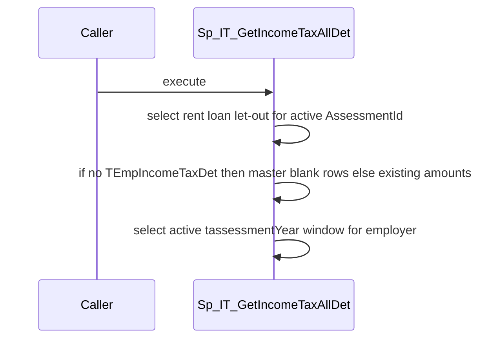
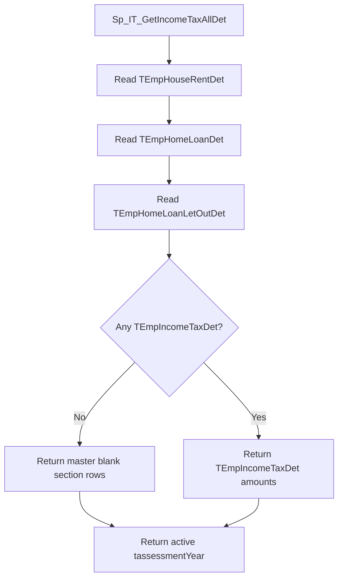

# Sp_IT_GetIncomeTaxAllDet

## What it does

Loads the Investment Declaration payload for one employee and employer. Returns five result sets for the active assessment year (`tassessmentYear.isactive = 'Y'`): house-rent row(s), home-loan row(s), let-out row(s), section-category amounts (either blank master-driven rows when the employee has no `TEmpIncomeTaxDet`, or existing `TEmpIncomeTaxDet` with form status), and the active assessment window (months/years).

## Parameters

| Name | Direction | What it is for |
|---|---|---|
| `@EmployerId` | in | Employer whose active assessment year and section masters are used |
| `@EmployeeId` | in | Employee whose rent, loan, let-out, and section rows are read |

## Call sequence

Calls no other procedures or functions.

## Callers

No other procedure or function calls this object. Application caller: Core Node `IncomeTaxDeclarationDAL.GetIncomeTaxSectionsAndCategories`.

## Nested

Calls no other procedures or functions.

## Steps

1. Script is `HRMS-DATABASE/HRMS/STOREPROCEDURE/Sp_IT_GetIncomeTaxAllDet.sql`.
2. Select from `TEmpHouseRentDet` for `@EmployeeId` and active `AssessmentId`.
3. Select from `TEmpHomeLoanDet` with the same filters.
4. Select from `TEmpHomeLoanLetOutDet` with the same filters.
5. Count `TEmpIncomeTaxDet` for the employee. If zero, return master section/category rows with empty amounts and `Isedit = N`. Else return existing `TEmpIncomeTaxDet` for the active assessment with `Isedit = Y` and form status from `ActualSubmitted`.
6. After the main `BEGIN`/`END` block (still in the procedure batch), select active `tassessmentYear` columns for `@EmployerId`.

## Tables

| Table | Read or write |
|---|---|
| `dbo.TEmpHouseRentDet` | read |
| `dbo.TEmpHomeLoanDet` | read |
| `dbo.TEmpHomeLoanLetOutDet` | read |
| `dbo.TEmpIncomeTaxDet` | read |
| `dbo.tassessmentYear` | read |
| `dbo.TIncomeTaxSection` | read |
| `dbo.TIncomeTaxCategoryType` | read |
| `dbo.TIncomeTaxSectionCategoryDet` | read |

## Flow

