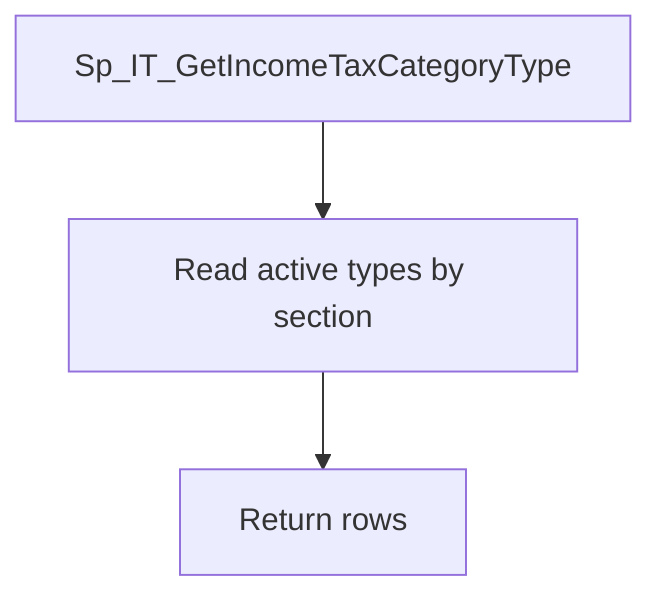

# Sp_IT_GetIncomeTaxCategoryType

## What it does

Returns active category-type id and name pairs for one income-tax section, ordered by name. Used by PayRoll Setup Masters Manage Categories when the section dropdown changes.

## Parameters

| Name | Direction | What it is for |
|---|---|---|
| `@Sectionid` | in | Parent section id |

## Call sequence

Calls no other procedures or functions.

## Callers

| Object | Kind | Page |
|---|---|---|
| `IncomeTaxDeclarationDAL.GetIncomeTaxCategoryTypesBySection` | app | [Setup Masters](/docs/guides/payroll/setup-masters) |

No other procedure in `STOREPROCEDURE/` executes it.

## Nested

Calls no other procedures or functions.

## Steps

1. Script is `HRMS-DATABASE/HRMS/STOREPROCEDURE/Sp_IT_GetIncomeTaxCategoryType.sql`.
2. `SELECT CategoryTypeName, IncomeTaxCategoryTypeId` from `TIncomeTaxCategoryType` where section matches and `IsActive = 'Y'`, ordered by name.

## Tables

| Table | Read or write |
|---|---|
| `dbo.TIncomeTaxCategoryType` | read |

## Unresolved calls

None.

## Flow

