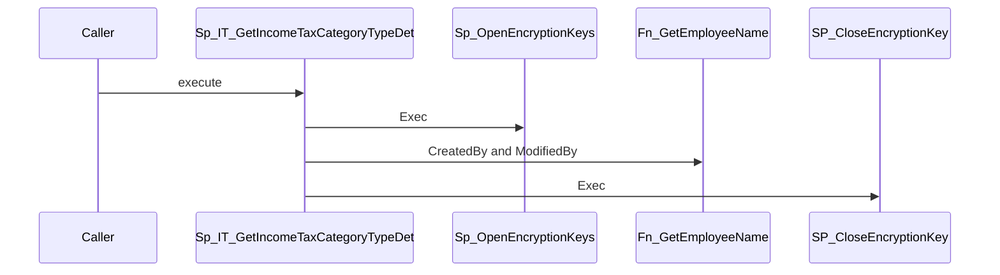
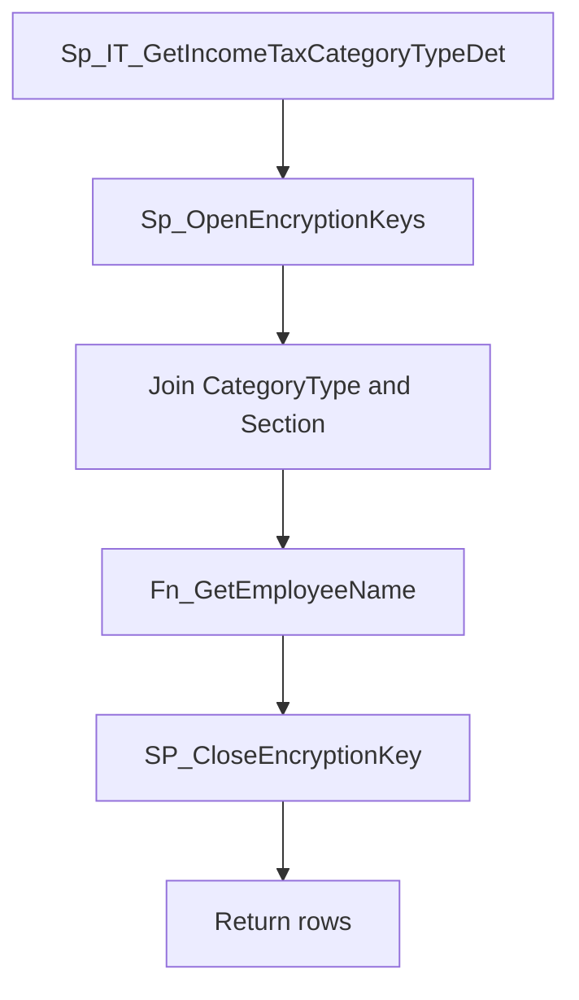

# Sp_IT_GetIncomeTaxCategoryTypeDet

## What it does

Returns category-type rows for an employer joined to their parent section name, with Active/InActive labels and creator/modifier names. Opens encryption keys for `Fn_GetEmployeeName`. Used by PayRoll Setup Masters Manage Category Types grid.

## Parameters

| Name | Direction | What it is for |
|---|---|---|
| `@Employerid` | in | Employer scope |

## Call sequence

## Callers

| Object | Kind | Page |
|---|---|---|
| `IncomeTaxDeclarationDAL.GetIncomeTaxCategoryTypes` | app | [Setup Masters](/docs/guides/payroll/setup-masters) |

No other procedure in `STOREPROCEDURE/` executes it.

## Nested

| Object | Kind | Role |
|---|---|---|
| `Sp_OpenEncryptionKeys` | procedure | Open keys before name resolution |
| `Fn_GetEmployeeName` | function | Creator/modifier display name |
| `SP_CloseEncryptionKey` | procedure | Close keys after select |

## Steps

1. Script is `HRMS-DATABASE/HRMS/STOREPROCEDURE/Sp_IT_GetIncomeTaxCategoryTypeDet.sql`.
2. `Exec Sp_OpenEncryptionKeys`.
3. `SELECT` from `TIncomeTaxCategoryType` inner join `TIncomeTaxSection` for `@Employerid`, ordered by `IsNull(ModifiedDate, CreatedDate) desc`.
4. `Exec SP_CloseEncryptionKey`.

## Tables

| Table | Read or write |
|---|---|
| `dbo.TIncomeTaxCategoryType` | read |
| `dbo.TIncomeTaxSection` | read |

## Unresolved calls

None.

## Flow

