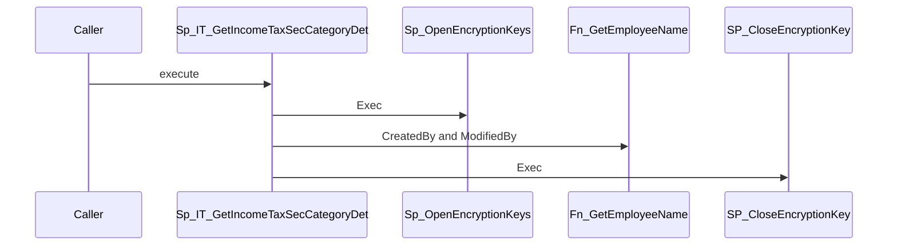
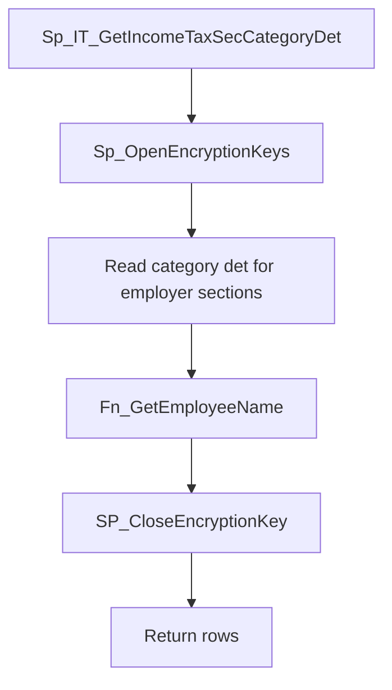

# Sp_IT_GetIncomeTaxSecCategoryDet

## What it does

Returns category detail rows for all sections belonging to an employer, with correlated section and category-type names, Yes/No limit, Active/InActive labels, and creator/modifier names. Opens encryption keys for `Fn_GetEmployeeName`. Used by PayRoll Setup Masters Manage Categories grid.

## Parameters

| Name | Direction | What it is for |
|---|---|---|
| `@Employerid` | in | Employer scope via parent sections |

## Call sequence

## Callers

| Object | Kind | Page |
|---|---|---|
| `IncomeTaxDeclarationDAL.GetIncomeTaxCategories` | app | [Setup Masters](/docs/guides/payroll/setup-masters) |

No other procedure in `STOREPROCEDURE/` executes it.

## Nested

| Object | Kind | Role |
|---|---|---|
| `Sp_OpenEncryptionKeys` | procedure | Open keys before name resolution |
| `Fn_GetEmployeeName` | function | Creator/modifier display name |
| `SP_CloseEncryptionKey` | procedure | Close keys after select |

Correlated subqueries also read `TIncomeTaxCategoryType` and `TIncomeTaxSection` for display names (not nested procedures).

## Steps

1. Script is `HRMS-DATABASE/HRMS/STOREPROCEDURE/Sp_IT_GetIncomeTaxSecCategoryDet.sql`.
2. `Exec Sp_OpenEncryptionKeys`.
3. `SELECT` from `TIncomeTaxSectionCategoryDet` where section is in employer sections, with name subqueries, ordered by `IsNull(ModifiedDate, CreatedDate) desc`.
4. `Exec SP_CloseEncryptionKey`.

## Tables

| Table | Read or write |
|---|---|
| `dbo.TIncomeTaxSectionCategoryDet` | read |
| `dbo.TIncomeTaxSection` | read |
| `dbo.TIncomeTaxCategoryType` | read |

## Unresolved calls

None.

## Flow

