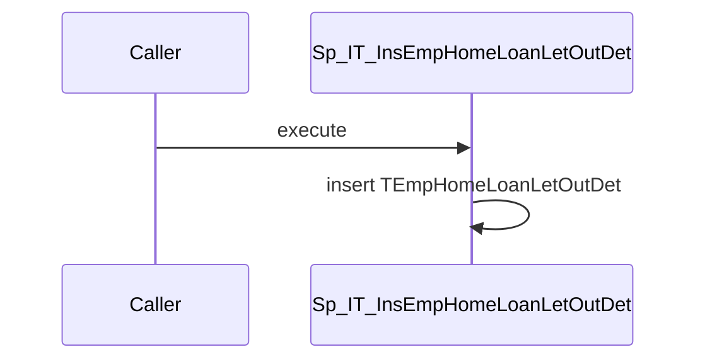
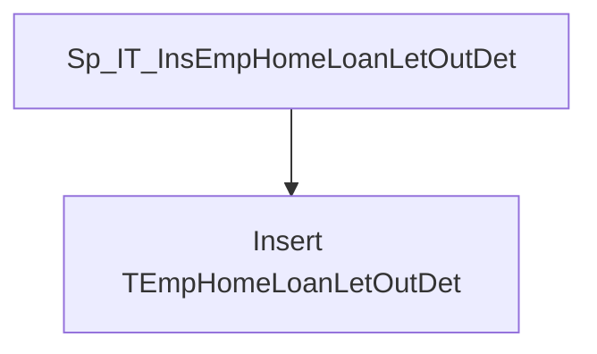

# Sp_IT_InsEmpHomeLoanLetOutDet

## What it does

Inserts one let-out property / home-loan let-out declaration row for an employee assessment.

## Parameters

| Name | Direction | What it is for |
|---|---|---|
| `@EmployerId` | in | Employer |
| `@AssessmentId` | in | Assessment year id |
| `@Employeeid` | in | Employee |
| `@EstAnnualRentRec` | in | Estimated annual rent received |
| `@EstMunicipalTaxPaid` | in | Estimated municipal tax |
| `@EstNetAnnualVal` | in | Estimated net annual value |
| `@ActAnnualRentRec` | in | Actual annual rent received |
| `@ActMunicipalTaxPaid` | in | Actual municipal tax |
| `@ActNetAnnualVal` | in | Actual net annual value |
| `@EstStandardDeduction` | in | Estimated standard deduction |
| `@RepayHomeLoan` | in | Y/N repaying home loan |
| `@EstPrincipalPaid` | in | Estimated principal paid |
| `@EstInterestPaid` | in | Estimated interest paid |
| `@EstNetIncome` | in | Estimated net income |
| `@ActStandardDeduction` | in | Actual standard deduction |
| `@ActPrincipalPaid` | in | Actual principal paid |
| `@ActInterestPaid` | in | Actual interest paid |
| `@ActNetIncome` | in | Actual net income |
| `@LenderName` | in | Lender name |
| `@LenderPan` | in | Lender PAN |
| `@IsEnabled` | in | Y/N enabled flag |
| `@CreatedBy` | in | Creating employee id |

## Call sequence

Calls no other procedures or functions.

## Callers

No other procedure or function calls this object. Application caller: Core Node `IncomeTaxDeclarationDAL` insert helpers used by `InsertITDeclaration` / update-when-id-0 paths.

## Nested

Calls no other procedures or functions.

## Steps

1. Script is `HRMS-DATABASE/HRMS/STOREPROCEDURE/Sp_IT_InsEmpHomeLoanLetOutDet.sql`.
2. Insert one row into `TEmpHomeLoanLetOutDet` with `CreatedDate = getdate()`.

## Tables

| Table | Read or write |
|---|---|
| `dbo.TEmpHomeLoanLetOutDet` | write |

## Flow

